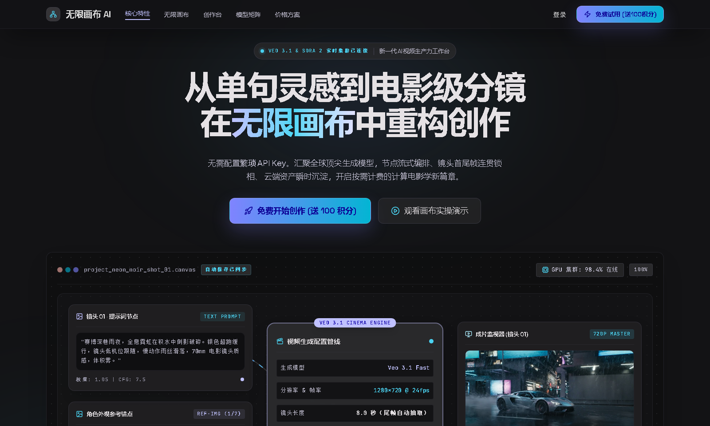
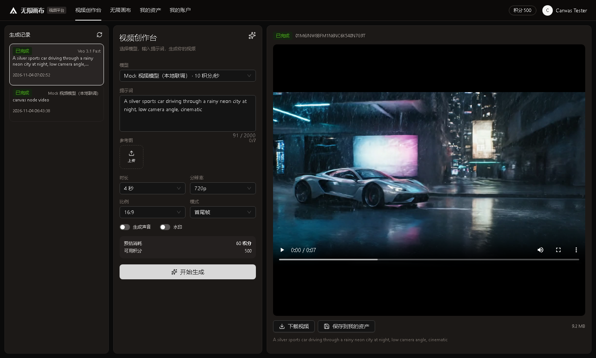
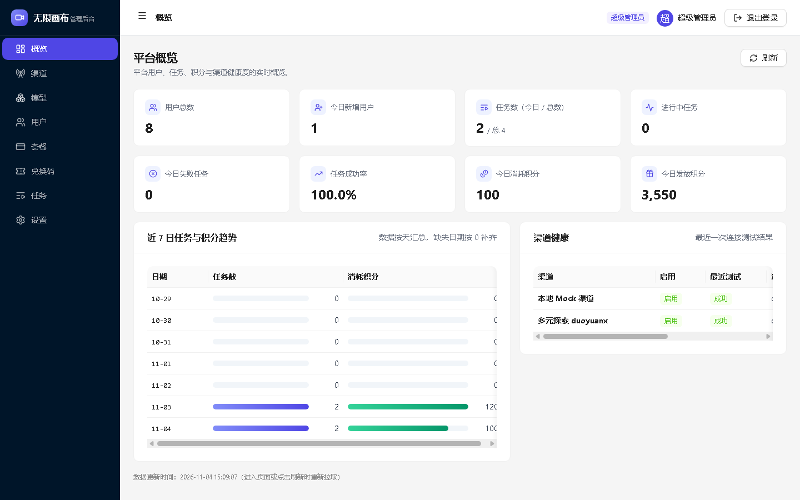
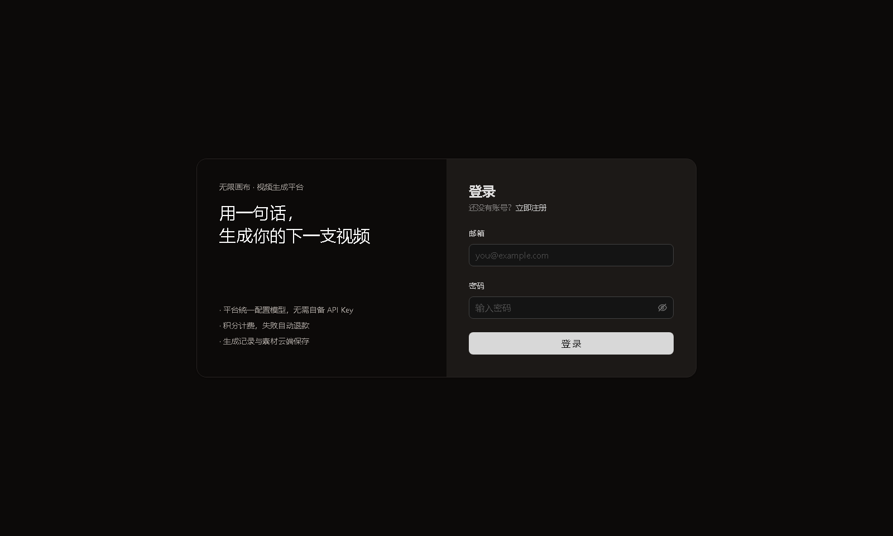
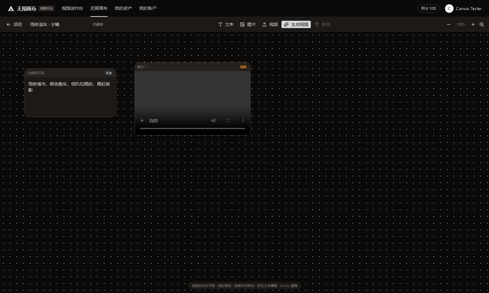
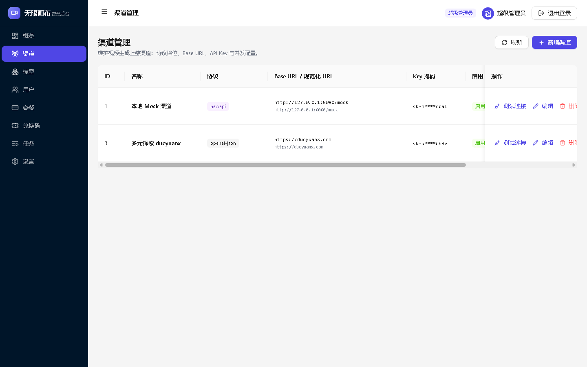
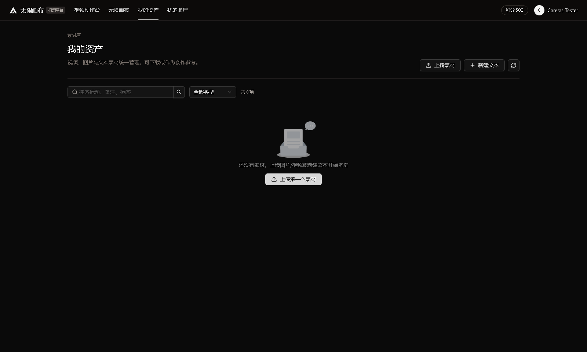
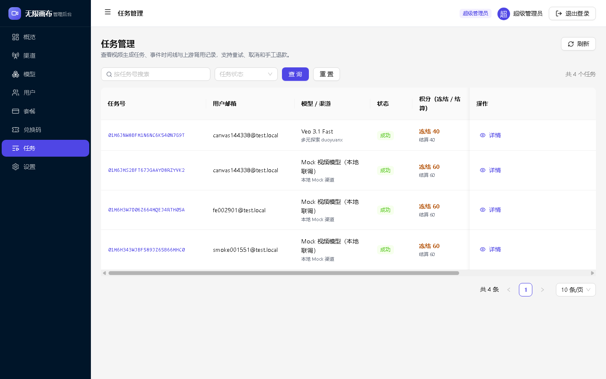

# 无限画布 · 视频生成平台（infinite-canvas-studio）

把参考项目 [infinite-canvas](D:\software\desk\infinite-canvas) 的「本地单人画布工具」升级为平台：注册登录、管理员配置 OpenAI 兼容视频模型、积分/套餐计费、云端画布与资产。

## 当前进度

| 阶段 | 状态 |
|---|---|---|
| M0 方案（PRD + 技术方案 + 范围契约） | ✅ 已完成（[docs/](docs/README.md)） |
| M1 后端 | ✅ 认证/模型/视频任务（创建/轮询/下载/结算/退款）/文件/资产/画布/管理端 CRUD/概览/设置 |
| M2 用户端前端 | ✅ 登录/注册、视频创作台、无限画布（列表+编辑器、云端保存）、我的资产、我的账户 |
| M3 画布改造 | ✅ 轻量画布 MVP：平移缩放、文本/图片/视频节点、选中素材生成视频、自动保存（连线和进阶能力待补） |
| M4 管理后台 | ✅ 9 个页面：登录/概览/渠道/模型/用户/套餐/兑换码/任务/设置 |
| M5 验收 | ✅ 真实上游已接入并验证：duoyuanx `veo_3_1-fast` 生成 1280x720 h264/aac 视频，平台落盘/播放/计费全链路通过（见 [真实上游接入记录](docs/REAL-UPSTREAM.md)） |

## 官网设计

官网采用 Google Stitch 导出的 **AetherCanvas Engine** 设计系统（深色 + 靛紫/青色霓虹、Space Grotesk / Plus Jakarta Sans / JetBrains Mono、节点式画布拟态）：字体与图片均本地托管，不依赖外部 CDN；Hero 与作品墙使用平台真实生成的 Veo 3.1 画面。实现见 `frontend/user_frontend/src/pages/home/index.tsx` 与 `src/styles/stitch.css`。

## 界面截图

| 官网 | 用户端 | 管理端 |
|---|---|---|
|  |  |  |
|  |  |  |
| — |  |  |

更多截图见 [docs/screenshots](docs/screenshots)。

## 目录

```
infinite-canvas-studio/
├─ docs/            # PRD、技术方案、范围契约、实现进度、截图、侦察与评审报告
├─ backend/         # Java 17 + Spring Boot 3.3 + MySQL 5.7 + 原生 MyBatis（见 backend/README.md）
├─ frontend/
│  ├─ user_frontend/    # React 19 + Vite + AntD 6 用户端（见 README）
│  ├─ admin_frontend/   # React 19 + Vite + AntD 6 管理端（见 README）
│  └─ scripts/          # UI 冒烟脚本（Chrome CDP 截图）
└─ .mvn/settings.xml    # 工作区本地 Maven 仓库（依赖不写系统盘）
```

## 已实现的后端能力（M1 完成）

- 账号：注册（赠送积分）、登录、refresh 轮换、登出、me、改昵称、改密码、禁用用户
- 管理端认证：独立账号/独立 JWT audience，用户 Token 访问管理接口 403
- 模型：用户端模型列表（参数能力 + 计价快照）；管理端渠道/模型 CRUD、连通性测试、AES-GCM 密钥
- 视频任务：multipart 创建（能力校验、并发上限、幂等键、HOLD 预扣）→ DB 轮询 → Mock/真实上游 create/query → 结果下载校验落盘 → 结算；失败/取消全额退款
- 计费：`HOLD/SETTLE/REFUND` 单幂等键互斥、不可变流水、管理员调账/充值/开通套餐、兑换码批次
- 文件：上传（类型/magic/大小校验）、HMAC 签名 URL、Range 206、篡改 403
- 资产：文本/图片/视频素材 CRUD、搜索筛选、签名 URL
- 画布：项目云同步、版本乐观锁、封面派生、软删
- 运营：概览指标/趋势/渠道健康、任务监控（事件+上游调用+流水+重试/退款/取消）、系统设置
- Mock 上游：dev profile `/mock/v1/videos`，支持失败注入
- 数据访问：原生 MyBatis（无 MyBatis-Plus），19 个 Mapper 的 SQL 手写在 `backend/src/main/resources/mapper/*.xml`
- 运行方式：`backend/README.md` 与 `backend/scripts/*.ps1`

## 快速验证

```powershell
# 1) 启动 MySQL 5.7（phpstudy，127.0.0.1:3306，root/123456，库 infinite_canvas_studio 自动创建）
# 2) 启动后端（推荐直接用 IntelliJ IDEA Run CanvasStudioApplication，零环境变量；
#    application-dev.yml 已内置本机数据库/存储默认值，详见 backend/README.md）
cd backend; mvn -s ..\.mvn\settings.xml -DskipTests package
java -jar target\canvas-studio-server.jar
# 3) 端到端 smoke
cd frontend\..\backend\scripts; powershell -NoProfile -ExecutionPolicy Bypass -File .\smoke.ps1
powershell -NoProfile -ExecutionPolicy Bypass -File .\smoke-admin.ps1
powershell -NoProfile -ExecutionPolicy Bypass -File .\verify-encoding.ps1
```

## 文档

- [文档索引](docs/README.md)
- [产品范围契约](docs/product-scope.md)
- [PRD](docs/PRD.md)
- [技术方案](docs/TECH-DESIGN.md)
- [前端盘点](docs/recon/frontend-inventory.md) / [视频协议侦察](docs/recon/openai-video-protocol.md) / [交叉评审](docs/recon/doc-review.md)

## 待用户确认（默认值已在实现中生效）

见 [PRD §15](docs/PRD.md)：上游测试账号、定价、支付方式（P1）、品牌/域名、文件保留策略等。默认值可在管理后台或 `system_setting` 调整。
