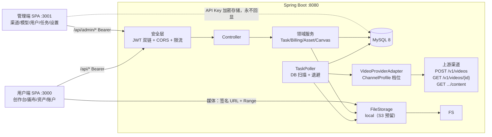
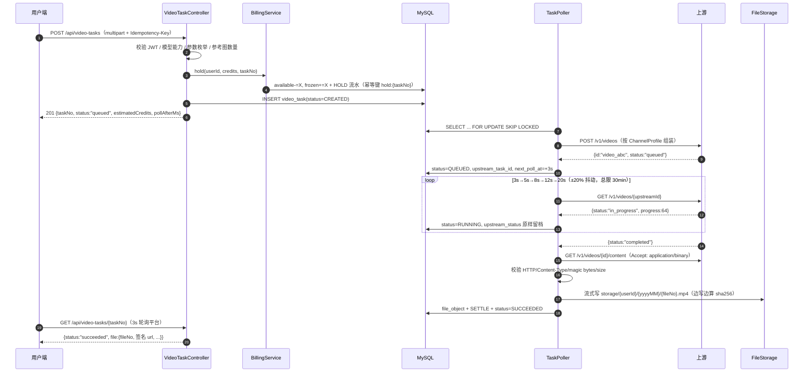

# 无限画布 · 视频生成平台 — 技术方案（TECH-DESIGN）

| 项 | 值 |
|---|---|
| 版本 / 状态 | v1.1（M0 交付物；已按独立评审修复 7 项 P0 与关键 P1，修订记录见附录 C） |
| 范围基线 | `docs/product-scope.md`（唯一范围来源；冲突以该文为准，差异见第 16 章） |
| 侦察依据 | `docs/recon/frontend-inventory.md`、`docs/recon/openai-video-protocol.md` |
| 目标仓库 | `D:\software\desk\infinite-canvas-studio`（`backend/` 现为 `com.companyname.bank` 骨架，两个前端目录为空） |
| 本机环境 | JDK 17.0.9 / Maven 3.9.2 / Node 22.19.0 / npm 11.21.1 / bun 1.4.4 |
| 数据库现状 | phpstudy MySQL 8.0.12，**端口 3307**、`default-storage-engine=MyISAM`、字符集 `utf8`、当前未启动 |
| 标记 | **MUST**=验收硬要求；**SHOULD**=本期尽量；**P1/P2**=本期不做、仅预留 |
## 0. 结论速览

| 主题 | 结论 | 理由 |
|---|---|---|
| 后端 | Spring Boot **3.3.5** + MyBatis-Plus **3.5.9** + Flyway **10.10.0** + MySQL 8 | 关键路径全是原生 SQL（扫描/扣减/对账），ORM 抽象是负资产 |
| 认证 | Spring Security 双过滤器链 + jjwt **0.12.6**；access 2h / refresh 30d | 用户端与管理端物理隔离，token 带 `aud` |
| 上游出口 | RestClient + `ChannelProfile` 档位 + `VideoProviderAdapter` SPI | 官方 Sora 已计划关停，聚合站方言是主战场 |
| 调度 | DB 扫描 `FOR UPDATE SKIP LOCKED` + 3s→20s 退避 + 30min 超时 | 多实例安全、宕机不丢任务 |
| 结果 | **必须下载落盘**，前端永不接触上游 URL | 上游链接 1h–24h 失效，透传等于暴露上游域名 |
| 计费 | 积分 BIGINT；HOLD→SETTLE/REFUND；不可变流水 + 幂等键 | 先扣后结算防超额；唯一键防重复扣退 |
| 定价 | `ceil(积分/秒 × 分辨率系数 × 音频系数 × 秒数)`，最低消费兜底 | 规则唯一、可单测 |
| 文件 | 本地磁盘 + `FileStorage` SPI（S3 预留）；HMAC 短时签名 URL + Range | 不裸奔静态目录，播放器需要 Range |
| 画布 | 项目 JSON 存 MySQL + `version` 乐观锁；媒体只存 fileNo | 云同步进 MVP，不把 base64 塞 JSON |
| 用户端 | 复制参考前端裁剪（React 19.2.5 / Vite 7.3 / antd 6.4.2 / Tailwind 4 / Zustand 5） | 保留核心交互资产，省 20+ 人日画布重写 |
| 管理端 | 新建 `frontend/admin_frontend`，同栈，`base=/admin/` | 参考项目 `pages/admin` 是空目录 |
| 端口 | 8080 / 3000 / 3001（Vite proxy `/api`） | 开发期同源免 CORS |
## 1. 方案总览
### 1.1 一句话定位
把"浏览器直连上游视频 API"的本地工具，改造成**平台托管密钥 + 服务端异步任务 + 积分计费 + 媒体自托管**的多用户 SaaS：用户端复用参考项目 UI 只换数据源，管理端新建，上游差异全部收敛在后端适配层。
### 1.2 系统架构



**三条硬约束**：① 前端绝不直连上游（否则密钥泄漏、无计费、无审计）；② 创建与轮询解耦（`POST` 只做校验 + 预扣 + 落库 + 返回）；③ 平台 ID（ULID `task_no`）与上游 ID 分离，永不复用。
### 1.3 请求时序：提交 → 上游 → 轮询 → 落盘 → 计费


### 1.4 核心不变量（评审清单）

| # | 不变量 | 强制手段 |
|---|---|---|
| I1 | `available >= 0` 且 `frozen >= 0` | 扣减 SQL 带 `WHERE available >= ?`，受影响行数 0 即拒 |
| I2 | 一个 task 最多一条终态资金流水（SETTLE 或 REFUND 二选一，不可同时存在） | `credit_transaction.idempotency_key` 唯一索引，双方共用 `finalize:{taskNo}`（P0-03） |
| I3 | SUCCEEDED 必有 `file_id` 且文件可读 | 状态迁移与 file_object 同事务；每日巡检 |
| I4 | 上游 URL 不出现在任何用户响应 | DTO 白名单；controller 层不可见 `upstream_*` |
| I5 | 同 `(user_id, idempotency_key)` 只产生一个任务 | 唯一索引；同键不同参返回 409 |
### 1.5 时间敏感风险（现在必须决定）
侦察报告确认：**OpenAI 官方 Sora API 在 SDK 中标注「2026-09-24 永久关停」**，当前已是 2026-11，官方 `/v1/videos` 大概率不可用。
> **结论**：首版对接目标**不是** api.openai.com，而是聚合站 / new-api 系中转站 / 自建 LiteLLM。`openai-official` 档位保留为"最像官方"的形态（Infistar、LiteLLM），但联调**必须提供聚合站账号**（Q1）。
> **本章设计决策**：重服务 + 薄前端，把六个易变点（协议、状态词、结果字段、密钥、计费、落盘）全关进后端。
> **为什么**：参考实现的六类问题（密钥泄漏、丢任务、链接失效、无计费/审计/多用户）**全部源于浏览器直连**；只换 UI 不改数据通路，问题一个都解决不了。
> **替代方案**：BFF 只转发不建任务表——被否，无法做轮询兜底、计费与落盘。
## 2. 技术选型与理由
### 2.1 版本矩阵

| 组件 | 版本 | 说明 |
|---|---|---|
| JDK / Maven | 17 / 3.9.2 | 本机已装，`--release 17` |
| Spring Boot | 3.3.5 | 3.3.x 最新 patch；不上 3.4+（生态未稳） |
| MySQL | 8.0.12 | 本机 phpstudy；DDL 规避 8.0.13+ 特性 |
| MyBatis-Plus | 3.5.9 | `mybatis-plus-spring-boot3-starter` |
| Flyway | 10.10.0（Boot BOM） | 必须加 `flyway-mysql`，否则启动报 Unsupported Database |
| springdoc-openapi | 2.6.0 | `-starter-webmvc-ui`，`/swagger-ui.html` |
| jjwt | 0.12.6 | api / impl / jackson |
| Caffeine | 3.1.8（BOM） | 登录计数、渠道冷却 |
| 测试 | JUnit5 / Mockito / MockMvc / MockWebServer 4.12.0 | 不上 Testcontainers（本机无 Docker） |
| 前端 | React 19.2.5 / Vite 7.3 / TS 5 / antd 6.4.2 / Tailwind 4 / Zustand 5 / RR 7.12 | 与参考前端一致 |
### 2.2 构建插件
`spring-boot-maven-plugin`（打可执行 jar）+ Boot parent 自带 `maven-compiler-plugin`（`<release>17</release>`）。**不引入** frontend-maven-plugin：前后端独立构建，前端产物交给 Nginx/部署脚本，塞进 Maven 只会拖慢后端 CI 且难排查。
### 2.3 持久层：JPA vs MyBatis-Plus —— **推荐 MyBatis-Plus**

| 判据 | MyBatis-Plus | JPA |
|---|---|---|
| 原生 SQL（本项目 8 处关键 SQL） | 直接 Mapper/XML | 需 `nativeQuery`，绕开 ORM 后优势尽失 |
| 余额原子更新 | `UPDATE ... WHERE available>=?` | 同样 native，还要管 flush/脏检查 |
| DDL 归属 | 交给 Flyway，实体只做映射 | `ddl-auto` 与 Flyway 冲突，易误开 `update` |
| CRUD 效率 | `BaseMapper` + Wrapper 够用 | 关联映射好用，但本项目刻意不建物理外键，收益低 |
| 主要风险 | 复杂动态 SQL 需手写 XML | N+1 / 懒加载 / 缓存 / 事务边界踩坑，排障成本高 |
> **决策**：MyBatis-Plus；实体 `@TableName`+`@TableId(AUTO)`，复杂 SQL 落 `resources/mapper/*.xml`。
> **为什么**：难点在事务正确性与原生 SQL，不在对象图映射；DDL 必须单一来源（Flyway），ORM 不该有建表权。
> **替代**：JPA + native query（语义不变，本文所有 SQL 可直接搬）；若团队 JPA 肌肉记忆强可切换。
### 2.4 Schema 管理：Flyway（不用 schema.sql）
`schema.sql` 每次全量执行、无法版本化/增量/校验，环境漂移不可见。Flyway 提供 `V1__init.sql`/`V2__seed.sql` 顺序执行 + 校验和 + `repair`。配置 `baseline-on-migrate=true`、`locations=classpath:db/migration`，**禁止任何运行时建表**。
### 2.5 HTTP 客户端：**RestClient**（排除 WebClient / OkHttp）

| 候选 | 结论与理由 |
|---|---|
| **RestClient**（Spring 6.1） | ✅ 同步阻塞，与事务/线程池模型一致；`MultipartBodyBuilder` 造 multipart；`exchange()` 拿 `InputStream` 流式下载（600s 大文件不 OOM）；异常统一 `RestClientResponseException` |
| WebClient | ❌ 引入 Reactor，但本项目无高并发 I/O（量级 = 用户数 × 并发 2），调试成本纯亏 |
| OkHttp | ❌ 更成熟但需自写 traceId/超时拦截器，与 Spring 编码/异常体系割裂 |

实现：`JdkClientHttpRequestFactory` + 连接池，每个请求用 `HttpRequest.Builder.timeout()` 单独设预算（create 90s / query 20s / content 900s）；**关闭自动重定向**（SSRF 需逐跳校验）。
### 2.6 其余选型

| 关注点 | 选型 | 说明 |
|---|---|---|
| JWT | jjwt 0.12.6 | `verifyWith(key)`；密钥 ≥256bit 来自环境变量 |
| 密码 | BCrypt cost=10 | 单次 60–100ms，天然抗爆破；不引 Argon2（native 依赖） |
| 对称加密 | JCE `AES/GCM/NoPadding`，IV 12B | 零依赖，GCM 自带完整性；密文格式 `v1:base64(iv‖ct‖tag)` |
| 参数校验 | starter-validation + `@StrongPassword` 等自定义注解 | 枚举/范围/跨字段在 DTO 层拒绝，非法参数绝不送上游 |
| 日志 | SLF4J + Logback + MDC（requestId/taskNo/userId） | 文本日志；审计明细进 DB（`upstream_call_log`） |
| 限流 | Caffeine 本地计数 | 登录失败、创建频率；P1 多实例换 Redis |
| 文件存储 | `FileStorage` SPI + `LocalFileStorage` | 根目录 `STORAGE_ROOT`；`S3FileStorage` 预留 |
| 测试 | JUnit5 + Mockito + MockMvc + MockWebServer | DAO 集成测试指向本机 `*_it` 库 |
### 2.7 `backend/pom.xml`

```xml
<project xmlns="http://maven.apache.org/POM/4.0.0"
         xmlns:xsi="http://www.w3.org/2001/XMLSchema-instance"
         xsi:schemaLocation="http://maven.apache.org/POM/4.0.0 https://maven.apache.org/xsd/maven-4.0.0.xsd">
  <modelVersion>4.0.0</modelVersion>
  <parent>
    <groupId>org.springframework.boot</groupId><artifactId>spring-boot-starter-parent</artifactId>
    <version>3.3.5</version><relativePath/>
  </parent>
  <groupId>com.infinitecanvas</groupId><artifactId>canvas-studio-server</artifactId>
  <version>0.1.0-SNAPSHOT</version><name>canvas-studio-server</name>
  <properties>
    <java.version>17</java.version>
    <mybatis-plus.version>3.5.9</mybatis-plus.version>
    <springdoc.version>2.6.0</springdoc.version>
    <jjwt.version>0.12.6</jjwt.version>
  </properties>
  <dependencies>
    <dependency><groupId>org.springframework.boot</groupId><artifactId>spring-boot-starter-web</artifactId></dependency>
    <dependency><groupId>org.springframework.boot</groupId><artifactId>spring-boot-starter-validation</artifactId></dependency>
    <dependency><groupId>org.springframework.boot</groupId><artifactId>spring-boot-starter-security</artifactId></dependency>
    <dependency><groupId>org.springframework.boot</groupId><artifactId>spring-boot-starter-actuator</artifactId></dependency>
    <dependency><groupId>com.baomidou</groupId><artifactId>mybatis-plus-spring-boot3-starter</artifactId><version>${mybatis-plus.version}</version></dependency>
    <!-- v3.5.9 起分页拦截器 PaginationInnerInterceptor 已拆出主包，必须显式引入 -->
    <dependency><groupId>com.baomidou</groupId><artifactId>mybatis-plus-jsqlparser</artifactId><version>${mybatis-plus.version}</version></dependency>
    <dependency><groupId>com.mysql</groupId><artifactId>mysql-connector-j</artifactId><scope>runtime</scope></dependency>
    <dependency><groupId>org.flywaydb</groupId><artifactId>flyway-core</artifactId></dependency>
    <dependency><groupId>org.flywaydb</groupId><artifactId>flyway-mysql</artifactId></dependency>
    <dependency><groupId>org.springdoc</groupId><artifactId>springdoc-openapi-starter-webmvc-ui</artifactId><version>${springdoc.version}</version></dependency>
    <dependency><groupId>io.jsonwebtoken</groupId><artifactId>jjwt-api</artifactId><version>${jjwt.version}</version></dependency>
    <dependency><groupId>io.jsonwebtoken</groupId><artifactId>jjwt-impl</artifactId><version>${jjwt.version}</version><scope>runtime</scope></dependency>
    <dependency><groupId>io.jsonwebtoken</groupId><artifactId>jjwt-jackson</artifactId><version>${jjwt.version}</version><scope>runtime</scope></dependency>
    <dependency><groupId>com.github.ben-manes.caffeine</groupId><artifactId>caffeine</artifactId></dependency>
    <dependency><groupId>org.projectlombok</groupId><artifactId>lombok</artifactId><optional>true</optional></dependency>
    <dependency><groupId>org.springframework.boot</groupId><artifactId>spring-boot-starter-test</artifactId><scope>test</scope></dependency>
    <dependency><groupId>org.springframework.security</groupId><artifactId>spring-security-test</artifactId><scope>test</scope></dependency>
    <dependency><groupId>com.squareup.okhttp3</groupId><artifactId>mockwebserver</artifactId><version>4.12.0</version><scope>test</scope></dependency>
  </dependencies>
  <build>
    <finalName>canvas-studio-server</finalName>
    <plugins>
      <plugin><groupId>org.springframework.boot</groupId><artifactId>spring-boot-maven-plugin</artifactId>
        <configuration><excludes><exclude><groupId>org.projectlombok</groupId><artifactId>lombok</artifactId></exclude></excludes></configuration>
      </plugin>
    </plugins>
  </build>
</project>
```
> 若 MP 3.5.9 与 Boot 3.3.5 冲突（`NoClassDefFoundError org/mybatis/spring/...`），先确认没引旧 starter；仍冲突则升 MP `3.5.10.1`（API 兼容）。
> **本章设计决策**：同步阻塞 + 显式 SQL 路线（MyBatis-Plus / Flyway / RestClient / jjwt）。
> **为什么**：这是"少量写、大量读状态"的异步任务系统，正确性（扣费幂等、状态机、落盘）远比抽象优雅重要；四人小组需要的是一眼能读懂的 SQL。
> **替代方案**：见 2.3 / 2.5 取舍表；P1 若需 10 万级并发轮询，再把 poller 拆独立进程并换 WebClient。
## 3. 后端工程结构
### 3.1 目录树

```
backend/
├─ pom.xml                                     # 见 2.7
├─ src/main/java/com/infinitecanvas/
│  ├─ CanvasStudioApplication.java             # @SpringBootApplication + @MapperScan("com.infinitecanvas.repository")
│  ├─ common/      ApiResponse, PageResult, ErrorCode, BizException, GlobalExceptionHandler,
│  │               Ulid, RequestIdFilter, JsonUtils, LogSanitizer
│  ├─ config/      JwtProperties, StorageProperties, PollerProperties, SecurityConfig,
│  │               CorsConfig, MybatisPlusConfig, OpenApiConfig, ExecutorConfig
│  ├─ security/    JwtService, JwtClaims, UserJwtAuthFilter, AdminJwtAuthFilter,
│  │               UserPrincipal, AdminPrincipal, AuthContext, LoginAttemptGuard, SsrfGuard
│  ├─ controller/  AuthController, ModelController, VideoTaskController, FileController,
│  │               AssetController, CanvasProjectController, AccountController
│  │  └─ admin/    AdminAuthController, AdminDashboardController, AdminChannelController,
│  │               AdminModelController, AdminUserController, AdminPlanController,
│  │               AdminTaskController, AdminRedeemCodeController, AdminSettingController
│  ├─ service/     AuthService, TokenService, VideoTaskService, TaskCreationService,
│  │               TaskQueryService, FileService, AssetService, CanvasProjectService,
│  │               AccountService, ChannelService, ModelService, SettingService, AuditService
│  ├─ domain/      entity/*（19 个）, enums/*（见 4.4）
│  ├─ repository/  UserMapper, CreditAccountMapper, VideoTaskMapper, FileObjectMapper … + 报表 Mapper
│  ├─ gateway/     VideoProviderAdapter, ChannelProfile, UpstreamClient, EnvelopeUnwrapper,
│  │               StatusMapper, UpstreamErrors, BaseUrlNormalizer, adapter/{OpenAiOfficial,NewApi,JsonEnvelope}Adapter
│  ├─ task/        TaskPoller, TaskStateMachine, ResultDownloader, PollBackoff,
│  │               TaskConcurrencyGuard, TaskRecoveryJob
│  ├─ billing/     BillingService, PricingService, CreditLedger, RedeemService, PlanService
│  └─ storage/     FileStorage, LocalFileStorage, S3FileStorage(P1), StoragePathResolver,
│                  DownloadTokenService, MediaValidator
├─ src/main/resources/
│  ├─ application.yml / -dev.yml / -prod.yml
│  ├─ db/migration/V1__init.sql, V2__seed.sql
│  ├─ mapper/*.xml                             # 扫描/扣减/对账等复杂 SQL
│  └─ logback-spring.xml
└─ src/test/java/com/infinitecanvas/            # 见 13 章
```
### 3.2 包职责与依赖规则

| 包 | 职责 | 禁止事项 |
|---|---|---|
| `common` | 响应/错误码/异常/分页/ID/MDC | 不依赖业务包 |
| `controller` | 参数绑定、校验、组装响应 | 不写业务、不直接调 Mapper |
| `service` | 事务编排与领域规则 | 不拼 HTTP 响应 |
| `repository` | SQL（简单用 Wrapper，复杂用 XML） | 不放业务判断 |
| `gateway` | 上游协议适配 | **唯一允许发起外网请求的包**；不得引用 controller/service |
| `task` | 状态机、调度、下载 | 不直接拼上游字段（走 gateway） |
| `billing` | 资金正确性 | 只有 `BillingService` 能改余额 |
| `storage` | 文件读写与签名 | 不暴露物理路径 |

依赖方向：`controller → service → (billing | task | storage | gateway) → repository`；`billing` 只经 `BillingService` 改 `credit_account`，任何 Mapper 直改都算缺陷。
> **设计决策**：技术分层 + 特性分包（gateway/task/billing/storage）混合，而非纯业务模块分包。
> **为什么**：计费与任务状态机是横切的正确性关注点，集中成包才能保证"只有一处能改余额、只有一处能出网"。
> **替代方案**：按 `video/`/`canvas/`/`asset/` 分包——被否，`billing` 被三处需要，易成循环依赖。
## 4. 数据模型
### 4.1 设计原则

1. **主键**：内部 `BIGINT UNSIGNED AI`；对外 `CHAR(26)` ULID（`task_no`/`project_no`/`asset_no`/`file_no`），时间有序、不可枚举。
2. **不建物理外键**：逻辑关联 + 应用校验 + 索引。软删除、批量清理、将来分库都与 FK 冲突；写入全经 service 层。
3. **积分 `BIGINT` 整数**（不可拆分）；**金额 `DECIMAL(18,4)`**。永不使用浮点计费。
4. **时间**：`DATETIME(3)` 存 UTC；接口输出 ISO-8601；`created_at/updated_at` 由 DB 兜底。
5. **状态用 `VARCHAR(24)` 而非 ENUM**：加状态不改表，取值由 Java 枚举校验。
6. **软删除**：仅 `asset`/`canvas_project` 用 `deleted_at`；`user` 只用 `status=DISABLED`；`channel`/`model`/`plan` 用 `enabled` 下架（避免唯一索引冲突与历史引用断裂）。
7. **JSON 列**：`params_json`/`references_json`/`resolution_factors`/`document_json`/`extra_headers`；应用层限 ≤4MB。
8. **MySQL 8.0.12 兼容**：不用 `DEFAULT (expr)`（8.0.13+）、不依赖 `CHECK`（8.0.16 才强制），跨列约束在应用层。
9. **时间基准统一 UTC（M0 评审修复）**：所有 `DATETIME(3)` 语义为 UTC；JDBC 连接必须带 `connectionTimeZone=UTC&forceConnectionTimeZoneToSession=true`（Connector/J 8.0.23+ 才会真正设置会话 `time_zone`，只写 `serverTimezone` 无效），并额外用 Hikari `connection-init-sql: SET time_zone = '+00:00'` 兜底。这样 `CURRENT_TIMESTAMP(3)`/`NOW(3)` 与应用写入的 UTC 时间同基准；`next_poll_at`、`deadline_at`、`created_at` 均由应用或 DB 以 UTC 生成。禁止在 SQL 里混用 `UNIX_TIMESTAMP()` 或依赖服务器本地时区。
10. **用户不软删**：`user` 仅用 `status=DISABLED`；软删除只用于 `asset`/`canvas_project`（见 4.6）。
### 4.2 逻辑关联（不建物理外键）
`user 1:1 credit_account`｜`user 1:N credit_transaction / video_task / asset / canvas_project / file_object / plan_order / user_plan / user_refresh_token`｜`plan 1:N plan_order / user_plan`｜`channel 1:N model`｜`model 1:N video_task`｜`video_task 1:N video_task_event / upstream_call_log`，`video_task 1:0..1 file_object`（`file_id`）｜`file_object 1:N asset`（`file_id`/`cover_file_id`）｜`admin_user 1:N channel`（审计用 `operator_admin_id`，不设引用约束）。
### 4.3 `V1__init.sql`（19 张表；字段中文语义见列 `COMMENT` 与 4.4）
> 每表**显式** `ENGINE=InnoDB` + `utf8mb4`：本机 phpstudy 默认 `MyISAM` + `utf8`，不覆盖就没有事务、存不了 emoji，直接毁掉计费与 JSON 行为。

```sql
-- V1__init.sql · 无限画布·视频生成平台
-- 约定：积分 BIGINT 整数；金额 DECIMAL(18,4)；时间 DATETIME(3) 存 UTC；不建物理外键
SET NAMES utf8mb4;
CREATE TABLE `user` (
  `id` BIGINT UNSIGNED NOT NULL AUTO_INCREMENT, `email` VARCHAR(190) NOT NULL, `password_hash` VARCHAR(72) NOT NULL, `display_name` VARCHAR(64) NOT NULL DEFAULT '', `status` VARCHAR(16) NOT NULL DEFAULT 'ACTIVE' COMMENT 'ACTIVE|DISABLED',
  `role` VARCHAR(16) NOT NULL DEFAULT 'USER', `last_login_at` DATETIME(3) NULL, `created_at` DATETIME(3) NOT NULL DEFAULT CURRENT_TIMESTAMP(3), `updated_at` DATETIME(3) NOT NULL DEFAULT CURRENT_TIMESTAMP(3) ON UPDATE CURRENT_TIMESTAMP(3),
  PRIMARY KEY (`id`), UNIQUE KEY `uk_user_email` (`email`), KEY `idx_user_status` (`status`,`created_at`)
) ENGINE=InnoDB DEFAULT CHARSET=utf8mb4 COLLATE=utf8mb4_0900_ai_ci;
CREATE TABLE `admin_user` (
  `id` BIGINT UNSIGNED NOT NULL AUTO_INCREMENT, `username` VARCHAR(64) NOT NULL, `password_hash` VARCHAR(72) NOT NULL, `display_name` VARCHAR(64) NOT NULL DEFAULT '', `role` VARCHAR(16) NOT NULL DEFAULT 'SUPER_ADMIN',
  `status` VARCHAR(16) NOT NULL DEFAULT 'ACTIVE', `last_login_at` DATETIME(3) NULL, `created_at` DATETIME(3) NOT NULL DEFAULT CURRENT_TIMESTAMP(3), `updated_at` DATETIME(3) NOT NULL DEFAULT CURRENT_TIMESTAMP(3) ON UPDATE CURRENT_TIMESTAMP(3),
  PRIMARY KEY (`id`), UNIQUE KEY `uk_admin_username` (`username`)
) ENGINE=InnoDB DEFAULT CHARSET=utf8mb4 COLLATE=utf8mb4_0900_ai_ci;
CREATE TABLE `user_refresh_token` (
  `id` BIGINT UNSIGNED NOT NULL AUTO_INCREMENT, `user_id` BIGINT UNSIGNED NOT NULL, `token_hash` CHAR(64) NOT NULL, `expires_at` DATETIME(3) NOT NULL, `revoked_at` DATETIME(3) NULL, `user_agent` VARCHAR(255) NOT NULL DEFAULT '',
  `ip` VARCHAR(45) NOT NULL DEFAULT '', `created_at` DATETIME(3) NOT NULL DEFAULT CURRENT_TIMESTAMP(3),
  PRIMARY KEY (`id`), UNIQUE KEY `uk_urt_hash` (`token_hash`), KEY `idx_urt_user` (`user_id`,`expires_at`)
) ENGINE=InnoDB DEFAULT CHARSET=utf8mb4 COLLATE=utf8mb4_0900_ai_ci;
CREATE TABLE `credit_account` (
  `user_id` BIGINT UNSIGNED NOT NULL, `available` BIGINT NOT NULL DEFAULT 0, `frozen` BIGINT NOT NULL DEFAULT 0, `total_consumed` BIGINT NOT NULL DEFAULT 0, `total_recharged` BIGINT NOT NULL DEFAULT 0,
  `updated_at` DATETIME(3) NOT NULL DEFAULT CURRENT_TIMESTAMP(3) ON UPDATE CURRENT_TIMESTAMP(3),
  PRIMARY KEY (`user_id`)
) ENGINE=InnoDB DEFAULT CHARSET=utf8mb4 COLLATE=utf8mb4_0900_ai_ci;
CREATE TABLE `credit_transaction` (
  `id` BIGINT UNSIGNED NOT NULL AUTO_INCREMENT, `user_id` BIGINT UNSIGNED NOT NULL, `biz_type` VARCHAR(24) NOT NULL COMMENT 'HOLD|SETTLE|SETTLE_ADJUST|REFUND|RECHARGE|GIFT|REDEEM|PLAN_GRANT|ADJUST',
  `available_delta` BIGINT NOT NULL, `frozen_delta` BIGINT NOT NULL, `balance_after` BIGINT NOT NULL COMMENT 'available 快照', `task_id` BIGINT UNSIGNED NULL, `order_id` BIGINT UNSIGNED NULL, `redeem_code_id` BIGINT UNSIGNED NULL,
  `idempotency_key` VARCHAR(128) NOT NULL, `operator_admin_id` BIGINT UNSIGNED NULL, `remark` VARCHAR(255) NOT NULL DEFAULT '', `request_id` VARCHAR(64) NOT NULL DEFAULT '',
  `created_at` DATETIME(3) NOT NULL DEFAULT CURRENT_TIMESTAMP(3),
  PRIMARY KEY (`id`), UNIQUE KEY `uk_ct_idem` (`idempotency_key`),
  KEY `idx_ct_user` (`user_id`,`created_at`), KEY `idx_ct_task` (`task_id`), KEY `idx_ct_biz` (`biz_type`,`created_at`)
) ENGINE=InnoDB DEFAULT CHARSET=utf8mb4 COLLATE=utf8mb4_0900_ai_ci;
CREATE TABLE `plan` (
  `id` BIGINT UNSIGNED NOT NULL AUTO_INCREMENT, `code` VARCHAR(32) NOT NULL, `name` VARCHAR(64) NOT NULL, `type` VARCHAR(16) NOT NULL DEFAULT 'CREDIT_PACK', `price_amount` DECIMAL(18,4) NOT NULL DEFAULT 0.0000,
  `credits` BIGINT NOT NULL DEFAULT 0, `bonus_credits` BIGINT NOT NULL DEFAULT 0, `valid_days` INT NOT NULL DEFAULT 0 COMMENT '0=永久', `description` VARCHAR(500) NOT NULL DEFAULT '', `sort` INT NOT NULL DEFAULT 0, `enabled` TINYINT NOT NULL DEFAULT 1,
  `created_at` DATETIME(3) NOT NULL DEFAULT CURRENT_TIMESTAMP(3), `updated_at` DATETIME(3) NOT NULL DEFAULT CURRENT_TIMESTAMP(3) ON UPDATE CURRENT_TIMESTAMP(3),
  PRIMARY KEY (`id`), UNIQUE KEY `uk_plan_code` (`code`), KEY `idx_plan_enabled` (`enabled`,`sort`)
) ENGINE=InnoDB DEFAULT CHARSET=utf8mb4 COLLATE=utf8mb4_0900_ai_ci;
CREATE TABLE `plan_order` (
  `id` BIGINT UNSIGNED NOT NULL AUTO_INCREMENT, `order_no` CHAR(26) NOT NULL, `user_id` BIGINT UNSIGNED NOT NULL, `plan_id` BIGINT UNSIGNED NULL, `type` VARCHAR(16) NOT NULL DEFAULT 'PURCHASE', `pay_method` VARCHAR(16) NOT NULL DEFAULT 'MANUAL',
  `amount` DECIMAL(18,4) NOT NULL DEFAULT 0.0000, `credits` BIGINT NOT NULL DEFAULT 0, `status` VARCHAR(16) NOT NULL DEFAULT 'PAID' COMMENT 'PENDING|PAID|CANCELLED|REFUNDED',
  `operator_admin_id` BIGINT UNSIGNED NULL, `remark` VARCHAR(255) NOT NULL DEFAULT '', `paid_at` DATETIME(3) NULL, `created_at` DATETIME(3) NOT NULL DEFAULT CURRENT_TIMESTAMP(3), `updated_at` DATETIME(3) NOT NULL DEFAULT CURRENT_TIMESTAMP(3) ON UPDATE CURRENT_TIMESTAMP(3),
  PRIMARY KEY (`id`), UNIQUE KEY `uk_order_no` (`order_no`), KEY `idx_po_user` (`user_id`,`created_at`)
) ENGINE=InnoDB DEFAULT CHARSET=utf8mb4 COLLATE=utf8mb4_0900_ai_ci;
CREATE TABLE `user_plan` (
  `id` BIGINT UNSIGNED NOT NULL AUTO_INCREMENT, `user_id` BIGINT UNSIGNED NOT NULL, `plan_id` BIGINT UNSIGNED NOT NULL, `order_id` BIGINT UNSIGNED NULL, `credits_total` BIGINT NOT NULL DEFAULT 0, `credits_used` BIGINT NOT NULL DEFAULT 0,
  `started_at` DATETIME(3) NOT NULL DEFAULT CURRENT_TIMESTAMP(3), `expires_at` DATETIME(3) NULL COMMENT 'NULL=永久', `status` VARCHAR(16) NOT NULL DEFAULT 'ACTIVE' COMMENT 'ACTIVE|EXPIRED', `created_at` DATETIME(3) NOT NULL DEFAULT CURRENT_TIMESTAMP(3),
  PRIMARY KEY (`id`), KEY `idx_up_user` (`user_id`,`status`,`expires_at`)
) ENGINE=InnoDB DEFAULT CHARSET=utf8mb4 COLLATE=utf8mb4_0900_ai_ci;
CREATE TABLE `redeem_code` (
  `id` BIGINT UNSIGNED NOT NULL AUTO_INCREMENT, `code` VARCHAR(32) NOT NULL, `batch_no` VARCHAR(32) NOT NULL DEFAULT '', `prefix` VARCHAR(8) NOT NULL DEFAULT '' COMMENT '运营前缀，用于区分渠道/活动', `credits` BIGINT NOT NULL DEFAULT 0, `plan_id` BIGINT UNSIGNED NULL COMMENT '非空=兑换套餐',
  `status` VARCHAR(16) NOT NULL DEFAULT 'UNUSED' COMMENT 'UNUSED|USED|DISABLED|EXPIRED', `used_by_user_id` BIGINT UNSIGNED NULL, `used_at` DATETIME(3) NULL, `expires_at` DATETIME(3) NULL,
  `created_by_admin_id` BIGINT UNSIGNED NULL, `created_at` DATETIME(3) NOT NULL DEFAULT CURRENT_TIMESTAMP(3),
  PRIMARY KEY (`id`), UNIQUE KEY `uk_redeem_code` (`code`), KEY `idx_rc_batch` (`batch_no`,`status`), KEY `idx_rc_user` (`used_by_user_id`)
) ENGINE=InnoDB DEFAULT CHARSET=utf8mb4 COLLATE=utf8mb4_0900_ai_ci;
CREATE TABLE `channel` (
  `id` BIGINT UNSIGNED NOT NULL AUTO_INCREMENT, `name` VARCHAR(64) NOT NULL, `protocol` VARCHAR(32) NOT NULL DEFAULT 'openai-official' COMMENT 'openai-official|newapi|json-envelope|dual-dialect',
  `base_url` VARCHAR(255) NOT NULL, `normalized_base_url` VARCHAR(255) NOT NULL COMMENT '已剥离 /v1 与 /videos', `api_key_cipher` VARBINARY(1024) NOT NULL COMMENT 'v1:base64(iv||ct||tag)', `api_key_mask` VARCHAR(32) NOT NULL DEFAULT '',
  `auth_type` VARCHAR(16) NOT NULL DEFAULT 'bearer' COMMENT 'bearer|api-key|x-api-key|custom', `auth_header` VARCHAR(64) NOT NULL DEFAULT '', `extra_headers` JSON NULL, `connect_timeout_ms` INT NOT NULL DEFAULT 5000, `read_timeout_ms` INT NOT NULL DEFAULT 60000,
  `max_concurrency` INT NOT NULL DEFAULT 8, `enabled` TINYINT NOT NULL DEFAULT 1, `last_test_at` DATETIME(3) NULL, `last_test_ok` TINYINT NULL, `last_test_message` VARCHAR(500) NOT NULL DEFAULT '',
  `created_at` DATETIME(3) NOT NULL DEFAULT CURRENT_TIMESTAMP(3), `updated_at` DATETIME(3) NOT NULL DEFAULT CURRENT_TIMESTAMP(3) ON UPDATE CURRENT_TIMESTAMP(3),
  PRIMARY KEY (`id`), UNIQUE KEY `uk_channel_name` (`name`), KEY `idx_channel_enabled` (`enabled`)
) ENGINE=InnoDB DEFAULT CHARSET=utf8mb4 COLLATE=utf8mb4_0900_ai_ci;
CREATE TABLE `model` (
  `id` BIGINT UNSIGNED NOT NULL AUTO_INCREMENT, `channel_id` BIGINT UNSIGNED NOT NULL, `upstream_model` VARCHAR(128) NOT NULL, `display_name` VARCHAR(64) NOT NULL,
  `capability` VARCHAR(16) NOT NULL DEFAULT 'video', `enabled` TINYINT NOT NULL DEFAULT 1, `sort` INT NOT NULL DEFAULT 0, `credits_per_second` DECIMAL(12,4) NOT NULL DEFAULT 10.0000 COMMENT '积分/秒（480p 基准）',
  `resolution_factors` JSON NOT NULL COMMENT '{"480p":1.0,"720p":1.5,"1080p":2.0}', `resolution_default` VARCHAR(16) NOT NULL DEFAULT '720p', `audio_factor` DECIMAL(6,4) NOT NULL DEFAULT 1.0000, `min_charge_credits` BIGINT NOT NULL DEFAULT 1,
  `supported_seconds` JSON NOT NULL COMMENT '["4","8","12"]', `supported_sizes` JSON NOT NULL, `supported_ratios` JSON NULL, `supports_audio` TINYINT NOT NULL DEFAULT 0, `supports_watermark` TINYINT NOT NULL DEFAULT 0,
  `supports_first_last_frame` TINYINT NOT NULL DEFAULT 0, `supports_reference_images` TINYINT NOT NULL DEFAULT 1, `max_reference_images` INT NOT NULL DEFAULT 1, `extra_request_params` JSON NULL COMMENT '渠道/模型级附加参数模板',
  `created_at` DATETIME(3) NOT NULL DEFAULT CURRENT_TIMESTAMP(3), `updated_at` DATETIME(3) NOT NULL DEFAULT CURRENT_TIMESTAMP(3) ON UPDATE CURRENT_TIMESTAMP(3),
  PRIMARY KEY (`id`), UNIQUE KEY `uk_model_channel_name` (`channel_id`,`upstream_model`), KEY `idx_model_list` (`enabled`,`sort`)
) ENGINE=InnoDB DEFAULT CHARSET=utf8mb4 COLLATE=utf8mb4_0900_ai_ci;
CREATE TABLE `video_task` (
  `id` BIGINT UNSIGNED NOT NULL AUTO_INCREMENT, `task_no` CHAR(26) NOT NULL, `user_id` BIGINT UNSIGNED NOT NULL, `channel_id` BIGINT UNSIGNED NOT NULL, `model_id` BIGINT UNSIGNED NOT NULL,
  `status` VARCHAR(24) NOT NULL COMMENT 'CREATED|SUBMITTING|SUBMIT_UNKNOWN|QUEUED|RUNNING|DOWNLOADING|SUCCEEDED|FAILED|CANCELLED|EXPIRED', `idempotency_key` VARCHAR(128) NULL, `request_hash` CHAR(64) NOT NULL COMMENT '入参指纹',
  `prompt` TEXT NOT NULL, `params_json` JSON NOT NULL, `references_json` JSON NOT NULL, `upstream_task_id` VARCHAR(191) NULL, `upstream_status` VARCHAR(32) NULL COMMENT '上游原始状态词，原样留档',
  `upstream_request_id` VARCHAR(191) NULL, `upstream_result_url` VARCHAR(2048) NULL COMMENT '仅审计，绝不对外', `result_expires_at` DATETIME(3) NULL, `progress` INT NOT NULL DEFAULT 0, `file_id` BIGINT UNSIGNED NULL,
  `held_credits` BIGINT NOT NULL DEFAULT 0, `settled_credits` BIGINT NOT NULL DEFAULT 0, `error_code` VARCHAR(64) NULL, `error_message` VARCHAR(1024) NULL COMMENT '已脱敏、面向用户的中文',
  `attempt_count` INT NOT NULL DEFAULT 0, `poll_count` INT NOT NULL DEFAULT 0, `next_poll_at` DATETIME(3) NULL, `deadline_at` DATETIME(3) NOT NULL COMMENT 'created_at+总时限', `submitted_at` DATETIME(3) NULL, `finished_at` DATETIME(3) NULL,
  `client_ip` VARCHAR(45) NOT NULL DEFAULT '', `client_request_id` VARCHAR(64) NOT NULL DEFAULT '', `created_at` DATETIME(3) NOT NULL DEFAULT CURRENT_TIMESTAMP(3), `updated_at` DATETIME(3) NOT NULL DEFAULT CURRENT_TIMESTAMP(3) ON UPDATE CURRENT_TIMESTAMP(3),
  PRIMARY KEY (`id`), UNIQUE KEY `uk_task_no` (`task_no`), UNIQUE KEY `uk_task_idem` (`user_id`,`idempotency_key`),
  KEY `idx_task_poll` (`status`,`next_poll_at`), KEY `idx_task_user` (`user_id`,`created_at`),
  KEY `idx_task_admin` (`status`,`created_at`), KEY `idx_task_channel` (`channel_id`,`created_at`)
) ENGINE=InnoDB DEFAULT CHARSET=utf8mb4 COLLATE=utf8mb4_0900_ai_ci;
CREATE TABLE `video_task_event` (
  `id` BIGINT UNSIGNED NOT NULL AUTO_INCREMENT, `task_id` BIGINT UNSIGNED NOT NULL, `from_status` VARCHAR(24) NOT NULL DEFAULT '', `to_status` VARCHAR(24) NOT NULL,
  `source` VARCHAR(16) NOT NULL DEFAULT 'SYSTEM' COMMENT 'USER|SYSTEM|POLLER|ADMIN', `detail` VARCHAR(1024) NOT NULL DEFAULT '', `created_at` DATETIME(3) NOT NULL DEFAULT CURRENT_TIMESTAMP(3),
  PRIMARY KEY (`id`), KEY `idx_vte_task` (`task_id`,`id`)
) ENGINE=InnoDB DEFAULT CHARSET=utf8mb4 COLLATE=utf8mb4_0900_ai_ci;
CREATE TABLE `upstream_call_log` (
  `id` BIGINT UNSIGNED NOT NULL AUTO_INCREMENT, `task_id` BIGINT UNSIGNED NOT NULL, `task_no` CHAR(26) NOT NULL, `action` VARCHAR(16) NOT NULL COMMENT 'CREATE|QUERY|CONTENT|CANCEL|MODELS', `attempt` INT NOT NULL DEFAULT 1,
  `http_status` INT NULL, `latency_ms` INT NULL, `upstream_request_id` VARCHAR(191) NULL, `error_code` VARCHAR(64) NULL, `response_snippet` VARCHAR(4096) NOT NULL DEFAULT '' COMMENT '脱敏后截断原文', `response_headers` JSON NULL,
  `created_at` DATETIME(3) NOT NULL DEFAULT CURRENT_TIMESTAMP(3),
  PRIMARY KEY (`id`), KEY `idx_ucl_task` (`task_id`,`created_at`), KEY `idx_ucl_taskno` (`task_no`,`created_at`)
) ENGINE=InnoDB DEFAULT CHARSET=utf8mb4 COLLATE=utf8mb4_0900_ai_ci;
CREATE TABLE `file_object` (
  `id` BIGINT UNSIGNED NOT NULL AUTO_INCREMENT, `file_no` CHAR(26) NOT NULL, `user_id` BIGINT UNSIGNED NOT NULL, `kind` VARCHAR(16) NOT NULL COMMENT 'UPLOAD|VIDEO_RESULT|COVER|AVATAR', `storage_provider` VARCHAR(16) NOT NULL DEFAULT 'local',
  `storage_key` VARCHAR(512) NOT NULL COMMENT '如 12/202611/01JABC....mp4', `original_name` VARCHAR(255) NOT NULL DEFAULT '', `content_type` VARCHAR(100) NOT NULL, `bytes` BIGINT NOT NULL, `sha256` CHAR(64) NOT NULL,
  `width` INT NULL, `height` INT NULL, `duration_ms` INT NULL, `ref_count` INT NOT NULL DEFAULT 0 COMMENT '被资产/画布/任务显式引用的计数，0 且超过保留期才物理删除', `status` VARCHAR(16) NOT NULL DEFAULT 'READY', `source_task_id` BIGINT UNSIGNED NULL, `created_at` DATETIME(3) NOT NULL DEFAULT CURRENT_TIMESTAMP(3), `deleted_at` DATETIME(3) NULL,
  PRIMARY KEY (`id`), UNIQUE KEY `uk_file_no` (`file_no`),
  KEY `idx_fo_user` (`user_id`,`created_at`), KEY `idx_fo_sha` (`sha256`), KEY `idx_fo_task` (`source_task_id`)
) ENGINE=InnoDB DEFAULT CHARSET=utf8mb4 COLLATE=utf8mb4_0900_ai_ci;
CREATE TABLE `asset` (
  `id` BIGINT UNSIGNED NOT NULL AUTO_INCREMENT, `asset_no` CHAR(26) NOT NULL, `user_id` BIGINT UNSIGNED NOT NULL, `kind` VARCHAR(16) NOT NULL COMMENT 'VIDEO|IMAGE|TEXT', `title` VARCHAR(200) NOT NULL DEFAULT '',
  `file_id` BIGINT UNSIGNED NULL, `cover_file_id` BIGINT UNSIGNED NULL, `text_content` MEDIUMTEXT NULL, `tags` JSON NULL, `source` VARCHAR(32) NOT NULL DEFAULT 'UPLOAD' COMMENT 'UPLOAD|GENERATE|CANVAS|VIDEO_PAGE', `note` VARCHAR(1000) NOT NULL DEFAULT '',
  `metadata` JSON NULL, `created_at` DATETIME(3) NOT NULL DEFAULT CURRENT_TIMESTAMP(3), `updated_at` DATETIME(3) NOT NULL DEFAULT CURRENT_TIMESTAMP(3) ON UPDATE CURRENT_TIMESTAMP(3), `deleted_at` DATETIME(3) NULL,
  PRIMARY KEY (`id`), UNIQUE KEY `uk_asset_no` (`asset_no`),
  KEY `idx_asset_user` (`user_id`,`deleted_at`,`created_at`), KEY `idx_asset_kind` (`user_id`,`kind`,`deleted_at`)
) ENGINE=InnoDB DEFAULT CHARSET=utf8mb4 COLLATE=utf8mb4_0900_ai_ci;
CREATE TABLE `canvas_project` (
  `id` BIGINT UNSIGNED NOT NULL AUTO_INCREMENT, `project_no` CHAR(26) NOT NULL, `user_id` BIGINT UNSIGNED NOT NULL, `title` VARCHAR(200) NOT NULL DEFAULT '未命名画布', `document_json` JSON NOT NULL COMMENT '{nodes,connections,backgroundMode,showImageInfo,viewport}',
  `node_count` INT NOT NULL DEFAULT 0, `file_count` INT NOT NULL DEFAULT 0, `document_bytes` INT NOT NULL DEFAULT 0 COMMENT '应用层限制 ≤4MB', `version` INT NOT NULL DEFAULT 1 COMMENT '乐观锁：每次 PUT +1',
  `created_at` DATETIME(3) NOT NULL DEFAULT CURRENT_TIMESTAMP(3), `updated_at` DATETIME(3) NOT NULL DEFAULT CURRENT_TIMESTAMP(3) ON UPDATE CURRENT_TIMESTAMP(3), `deleted_at` DATETIME(3) NULL,
  PRIMARY KEY (`id`), UNIQUE KEY `uk_project_no` (`project_no`), KEY `idx_cp_user` (`user_id`,`deleted_at`,`updated_at`)
) ENGINE=InnoDB DEFAULT CHARSET=utf8mb4 COLLATE=utf8mb4_0900_ai_ci;
CREATE TABLE `system_setting` (
  `setting_key` VARCHAR(64) NOT NULL, `setting_value` VARCHAR(2048) NOT NULL DEFAULT '', `value_type` VARCHAR(16) NOT NULL DEFAULT 'STRING' COMMENT 'STRING|INT|BOOL|DECIMAL|JSON', `description` VARCHAR(255) NOT NULL DEFAULT '',
  `updated_by_admin_id` BIGINT UNSIGNED NULL, `updated_at` DATETIME(3) NOT NULL DEFAULT CURRENT_TIMESTAMP(3) ON UPDATE CURRENT_TIMESTAMP(3),
  PRIMARY KEY (`setting_key`)
) ENGINE=InnoDB DEFAULT CHARSET=utf8mb4 COLLATE=utf8mb4_0900_ai_ci;
CREATE TABLE `audit_log` (
  `id` BIGINT UNSIGNED NOT NULL AUTO_INCREMENT, `actor_type` VARCHAR(16) NOT NULL COMMENT 'ADMIN|USER|SYSTEM', `actor_id` BIGINT UNSIGNED NULL, `action` VARCHAR(64) NOT NULL, `target_type` VARCHAR(32) NOT NULL DEFAULT '',
  `target_id` VARCHAR(64) NOT NULL DEFAULT '', `detail_json` JSON NULL, `ip` VARCHAR(45) NOT NULL DEFAULT '', `request_id` VARCHAR(64) NOT NULL DEFAULT '', `created_at` DATETIME(3) NOT NULL DEFAULT CURRENT_TIMESTAMP(3),
  PRIMARY KEY (`id`), KEY `idx_al_actor` (`actor_type`,`actor_id`,`created_at`), KEY `idx_al_target` (`target_type`,`target_id`,`created_at`)
) ENGINE=InnoDB DEFAULT CHARSET=utf8mb4 COLLATE=utf8mb4_0900_ai_ci;
```
### 4.4 枚举字典

| 枚举 | 取值 |
|---|---|
| `TaskStatus`（内部 10 态） | `CREATED`/`SUBMITTING`/`SUBMIT_UNKNOWN`/`QUEUED`/`RUNNING`/`DOWNLOADING`/`SUCCEEDED`/`FAILED`/`CANCELLED`/`EXPIRED` |
| 对外状态（5 态） | `queued`(CREATED/SUBMITTING/SUBMIT_UNKNOWN/QUEUED)/`running`(RUNNING/DOWNLOADING)/`succeeded`/`failed`(含 EXPIRED)/`cancelled` |
| `ModelCapability` | `video`（本期只做视频；API 层小写、DB 层同一小写，禁止混用大写） |
| `CreditBizType` | `HOLD`/`SETTLE`/`SETTLE_ADJUST`/`REFUND`/`RECHARGE`/`GIFT`/`REDEEM`/`PLAN_GRANT`/`ADJUST` |
| `ChannelProtocol` | `openai-official`/`newapi`/`json-envelope`/`dual-dialect` |
| `AssetKind` / `FileKind` | `VIDEO`/`IMAGE`/`TEXT` ｜ `UPLOAD`/`VIDEO_RESULT`/`COVER`/`AVATAR` |
| `UserStatus` / `PlanType` / `RedeemStatus` | `ACTIVE`/`DISABLED` ｜ `CREDIT_PACK`/`PLAN` ｜ `UNUSED`/`USED`/`DISABLED`/`EXPIRED` |
### 4.5 `V2__seed.sql`（非敏感种子，可重复执行）

```sql
INSERT INTO system_setting (setting_key, setting_value, value_type, description) VALUES
 ('credit.exchange_per_yuan','100','INT','1 元兑换积分'), ('user.register_gift_credits','100','INT','注册赠送积分'),
 ('task.max_concurrency_per_user','2','INT','每用户并发生成上限'), ('task.poll_timeout_minutes','30','INT','任务总时限'),
 ('task.base_backoff_seconds','3','INT','首次轮询间隔'), ('task.max_backoff_seconds','20','INT','轮询间隔上限'),
 ('file.max_upload_image_mb','20','INT','单文件上传上限（图片）'), ('file.max_upload_video_mb','200','INT','单文件上传上限（视频）'),
 ('site.notice','','STRING','顶部维护公告（空=不展示）'), ('user.registration_open','true','BOOL','是否开放注册'),
 ('file.retention_days','0','INT','0=永久保留'), ('security.login_max_failures','5','INT','登录失败阈值'),
 ('security.allow_private_upstream','false','BOOL','是否允许内网 Base URL（SSRF 例外）')
ON DUPLICATE KEY UPDATE description = VALUES(description);
INSERT INTO plan (code, name, type, price_amount, credits, bonus_credits, valid_days, sort, enabled) VALUES
 ('pack_10','体验包 1000 积分','CREDIT_PACK',10.0000,1000,0,0,10,1),
 ('pack_50','标准包 5500 积分','CREDIT_PACK',50.0000,5000,500,0,20,1),
 ('plan_pro','专业套餐 20000 积分','PLAN',200.0000,20000,0,30,30,1)
ON DUPLICATE KEY UPDATE name = VALUES(name);
```

**管理员账号不用 SQL 种子**（无法在 SQL 里算 BCrypt，且密码不该进仓库）：由 `AdminSeeder`（`ApplicationRunner`）在 `admin_user` 为空时用 `ADMIN_INIT_USERNAME/PASSWORD` 创建。开发环境额外有 `@Profile("dev")` 的 `DemoDataSeeder`：一个 `enabled=false` 示例渠道 + 模型 + 兑换码 `WELCOME-1000`（1000 积分）。
### 4.6 精度、软删除与巡检

| 项 | 策略 |
|---|---|
| 积分/金额 | 积分 `BIGINT`、最小单位 1；金额 `DECIMAL(18,4)`；展示格式化为 2 位 |
| 软删除 | `asset`/`canvas_project` 用 `deleted_at`，查询强制过滤；物理删除由清理任务在引用计数为 0 且超 `retention` 后执行 |
| 流水不可变 | 应用层无 UPDATE/DELETE 方法；生产 DB 账号对 `credit_transaction` 只授 `SELECT,INSERT` |
| 每日 03:00 巡检 | ①`frozen` 与未终态任务 `held` 之和不符 → 告警；②`SUCCEEDED` 但 `file_id IS NULL` → 告警；③`available+frozen<0` → 告警；④孤儿文件（无引用 >7 天）清理 |
> **设计决策**：不建物理外键、积分整数、状态字符串、画布文档与定价快照用 JSON。
> **为什么**：①软删除 + 物理外键 = 迁移地狱；②积分必须整数，才能让"扣费幂等"可证明；③画布文档是前端 schema，后端不应理解其内部结构（只校验大小与版本），否则每加一种节点都要改表；④定价快照保证"当时多少钱"可回放，管理员事后改价不影响历史任务。
> **替代方案**：画布节点建关系表——被否，节点类型是前端开放 schema（`CanvasNodeData`），与"复用参考前端"决策直接冲突；P1 若需服务端搜索节点，再补 `canvas_node` 派生表。
## 5. 鉴权与权限
### 5.1 JWT 结构

```json
// Header {"alg":"HS256","typ":"JWT"}
{ "iss":"infinite-canvas", "aud":"user", "sub":"10023", "role":"USER",
  "ctx":"access", "jti":"01JCV8Z3K9WQ7YH2N5R8T6B4XM", "iat":1762150000, "exp":1762157200 }
```

| 项 | 决策 |
|---|---|
| 算法/密钥 | HS256；`JWT_SECRET` ≥32 字节随机串；**缺失直接启动失败**（不用默认值） |
| access | TTL **2 小时**（任务可能挂 30 分钟，太短会轮询中途 401） |
| refresh | TTL **30 天**，`ctx=refresh` 只能换 token；DB 只存 SHA-256 哈希 |
| 轮换 | 每次 refresh 吊销旧 token 签发新 token；**并发刷新宽限**：旧 token 在 `revoked_at + 60s` 内被再次使用视为多标签并发，返回同一新 token，不做「复用检测」；超过宽限的吊销 token 复用 → 吊销该用户全部 token（M0 评审修复 P1-24） |
| 前端 | access/refresh 存 localStorage（`ic_access_token`/`ic_refresh_token`）；401+`AUTH_40103` 自动续期一次，失败清 token 跳登录 |

**风险**：localStorage 有 XSS 风险。MVP 接受（无第三方脚本）；P1 改 HttpOnly Cookie + CSRF token。
### 5.2 用户端与管理端隔离

| 维度 | 用户端 | 管理端 |
|---|---|---|
| 账号表 | `user` | `admin_user`（**独立表**，不是 `user.role`） |
| 入口 / JWT `aud` | `/api/**` / `user` | `/api/admin/**`（登录 `/api/admin/auth/login`）/ `admin` |
| 过滤器链 | `@Order(1)` `AdminJwtAuthFilter` + `SecurityFilterChain securityMatcher("/api/admin/**")`：仅 `/api/admin/auth/login` permitAll，其余 `.anyRequest().hasRole("ADMIN")` | `@Order(2)` `UserJwtAuthFilter` + `SecurityFilterChain securityMatcher("/api/**")`：`/api/admin/**` 显式 denyAll，其余 `authenticated()`；`/api/public/**`、`/api/auth/(register|login|refresh)` permitAll |
| 前端存储键 | `ic_access_token` | `ic_admin_access_token`（两套 SPA 独立，不复用） |
| 越权兜底 | 用户 token 的 `aud≠admin`，在链 1 即被 403 拒绝 | — |
> **决策**：管理员独立表 + 独立 audience，不用 `user.role='ADMIN'`。
> **为什么**：管理员没有积分/资产/画布却拥有改价与调账权；混在一张表里，一旦注册 DTO 漏了 `@JsonIgnore` 就是提权漏洞。分表让"成为管理员"必须由运维/环境变量操作。
> **替代**：`user.role` + `@PreAuthorize`——少一张表，但把提权面暴露在与用户输入同一张表上。
### 5.3 密码与登录防护

| 项 | 规则 |
|---|---|
| 密码强度 | 8–32 字符，必须同时含字母+数字，不得等于邮箱；`@StrongPassword` 后端校验、前端同步提示 |
| 存储 | `BCryptPasswordEncoder(10)`；永不记录明文 |
| 登录限流 | key=`lower(email)|ip`：5 次失败/10 分钟 → 锁 15 分钟，429 `AUTH_42901`；成功清零 |
| 注册限流 | 同 IP 10 次/小时 → 429 `AUTH_42902` |
| 改密 | 需旧密码；成功吊销全部 refresh token；写审计 |
| 禁用用户 | 登录 403 `AUTH_40302`；过滤器每次校验状态（Caffeine 缓存 60s）使已签发 token 失效 |
### 5.4 CORS / CSRF / 安全头

- CORS 只允许 `CORS_ALLOWED_ORIGINS`（禁止 `*`），`allowCredentials=false`（token 走 Header），暴露 `X-Request-Id`/`Content-Range`/`Accept-Ranges`。
- **CSRF 关闭**：无状态 Bearer，无浏览器自动携带凭据；P1 若改 Cookie 必须重新开启。
- 响应头：`X-Content-Type-Options: nosniff`、`X-Frame-Options: DENY`、`Referrer-Policy: no-referrer`。
- Actuator 只暴露 `health,info`，`/actuator/**` 仅内网可访问。
### 5.5 敏感信息脱敏

| 位置 | 处理 |
|---|---|
| 渠道列表/详情 | 只返回 `apiKeyMask`（`sk-ab****yz`，存 `api_key_mask`），**没有查看明文接口** |
| 日志 | `Authorization`/`api_key`/`Set-Cookie`/签名 URL/`password` 统一脱敏；`LogSanitizer` + logback `%replace` 双保险 |
| 上游错误 | 原文只进 `upstream_call_log`（截 4KB、脱敏）；对外只回平台错误码 + 中文文案 + `requestId` |
| 用户列表 | 邮箱默认 `ab***@example.com`；超级管理员 `?unmask=true` 显式请求并写审计 |
### 5.6 上传文件校验（`MediaValidator`）

| 检查 | 规则 |
|---|---|
| 大小 | 图片 ≤20MB、视频 ≤200MB（可配）；`multipart.max-file-size=200MB` |
| 白名单 | 图片 `jpg/jpeg/png/webp`；视频 `mp4/webm` |
| **magic bytes** | JPEG `FFD8FF`；PNG `89504E47`；WEBP `RIFF`+偏移 8 `WEBP`；MP4 偏移 4 `ftyp`；WEBM `1A45DFA3` |
| 图片尺寸 | `ImageIO` 可解码、≤8192px（防解压炸弹，`setUseCache(false)`） |
| 命名 | 丢弃原文件名（只存 `original_name` 展示），磁盘名 = ULID + 规范扩展名 |
| 路径 | `StoragePathResolver` 对最终路径 `normalize()` 后校验根前缀，杜绝 `..` |
### 5.7 SSRF 防护（三道入口，`SsrfGuard`）

| 入口 | 信任级别 | 校验点 |
|---|---|---|
| 渠道 `base_url` | 半可信 | scheme/host/port/userinfo/无 `..`；拒绝 path 含 `/videos`、`/v1/videos`、`/v1beta`；`allow_private_upstream=false` 时拒绝内网 |
| 上游结果 URL | **不可信** | DNS 解析后逐 IP 校验；关闭自动重定向，最多 3 跳且每跳重校验 |
| 用户参考图 | 可信 | 只收 `fileNo`（平台上传），**不接受 URL**，从根上消除"用户 URL 被上游拉取" |

```java
public void assertAllowed(URI uri) {
    require(uri.getScheme().equals("https") || allowHttp, "SSRF_SCHEME");
    require(uri.getUserInfo() == null, "SSRF_USERINFO");
    require(!BLACKLIST.matches(uri.getHost()), "SSRF_HOST");        // localhost/*.local/*.internal/metadata.google.internal
    require(ALLOWED_PORTS.contains(port(uri)), "SSRF_PORT");        // 443(可配 80)
    for (InetAddress a : InetAddress.getAllByName(uri.getHost()))   // 关键：校验解析后的全部 IP，防 DNS rebinding
        require(!a.isLoopbackAddress() && !a.isSiteLocalAddress() && !a.isLinkLocalAddress()
             && !a.isAnyLocalAddress() && !isUniqueLocalV6(a) && !isCgnat(a), "SSRF_PRIVATE_IP");
}
// 下载时：目标 host ≠ 渠道 host 则绝不携带上游 Authorization 头
```
### 5.8 越权校验规则

1. 用户侧查询**强制带 `user_id` 条件**，禁止"先按 id 查再比较 owner"。
2. 路径统一用 ULID（`task_no`/`project_no`/`asset_no`/`file_no`），不暴露自增 id；非本人记录一律 **404**（不返回 403，避免探测存在性）。
3. 文件下载走签名 token（9.3），token 绑定 `fileNo+userId+exp`。
4. 管理端写操作（改渠道/改价/调账/禁用）必须写 `audit_log`。
5. 单测必覆盖：B 读 A 的任务/资产/画布/文件 → 404。
## 6. API 契约
### 6.1 通用约定

| 项 | 约定 |
|---|---|
| Base Path | 用户端 `/api/**`；管理端 `/api/admin/**` |
| 编码 | UTF-8；JSON `application/json`；上传 `multipart/form-data` |
| 认证 | `Authorization: Bearer <access>`；媒体下载允许 `?exp&u&sig`（9.3） |
| 统一响应 | `{code,message,data,requestId,timestamp}`；成功 `code="OK"`、HTTP 200（创建 201） |
| 错误 | HTTP 状态与 `code` 前缀一致；`message` 面向用户中文；`data` 可带结构化上下文 |
| 分页 | `?page=1&pageSize=20`（≤100）→ `{items,page,pageSize,total,hasNext}` |
| 时间 | ISO-8601 UTC：`2026-11-03T15:04:05.123Z` |
| 请求 ID | 头 `X-Request-Id` 可传（≤64），不传则生成 ULID；响应头与体都返回 |
| 幂等 | `POST /api/video-tasks` **必须**带 `Idempotency-Key`（UUID，24h）；同键同参返回原任务，同键不同参 409 |

```json
// 成功
{"code":"OK","message":"","data":{"taskNo":"01JCV8Z4Q1M8R2T7X9B3K6N0PA"},"requestId":"01JCV…","timestamp":"2026-11-03T15:04:05.123Z"}
// 失败：积分不足
{"code":"BILL_40201","message":"积分不足：本次需要 120 积分，当前可用 12 积分",
 "data":{"required":120,"available":12},"requestId":"01JCV…","timestamp":"2026-11-03T15:04:05.123Z"}
```
### 6.2 错误码（`<域>_<HTTP><2位序号>`，前端按 code 分支，不解析 message）

| 域 | 码 |
|---|---|
| VALID 400 | `40001` 参数校验（`data.fields`）｜`40002` 参数组合不支持（如 frames 传 3 图）｜`40003` 模型能力不支持｜`40004` 媒体类型/文件损坏 |
| AUTH 401 | `40101` 未登录｜`40102` token 无效｜`40103` token 过期（用 refresh）｜`40104` 账号或密码错误 |
| AUTH 403 | `40301` 角色不足｜`40302` 账号已禁用｜`40303` refresh 已吊销 |
| AUTH 409/429 | `40901` 邮箱已注册｜`42901` 登录失败过多（`data.retryAfterSeconds`）｜`42902` 注册超频 |
| BILL 402 | `40201` 积分不足｜`40202` 兑换码无效/已用/过期 |
| BILL 400/409 | `40001` 调账参数非法｜`40901` 重复兑换 |
| TASK | `40401` 任务不存在（含非本人）｜`40901` 状态不允许该操作｜`40902` 幂等键冲突（同键不同参）｜`42901` 超并发上限 |
| CHANNEL 422 | `42201` Base URL 非法｜`42202` 连通性测试失败 |
| UPSTREAM 502/504 | `50201` 上游鉴权失败｜`50202` 上游限流｜`50203` 上游余额不足｜`50204` 内容风控｜`50205` 响应格式无法识别｜`50401` 超时（已退款） |
| CANVAS | `40401` 不存在｜`40901` 版本冲突（`data.currentVersion`）｜`41301` 文档 >4MB |
| UPLOAD/SYS | `41301` 文件过大｜`SYS_50001` 内部错误（不泄露堆栈）｜`SYS_50301` 维护模式/磁盘保护 |
### 6.3 用户端接口

| 方法 | 路径 | 鉴权 | 请求 / 响应要点 |
|---|---|---|---|
| GET | `/api/public/settings` | 无 | `{registrationOpen, notice, exchangePerYuan}`（登录/注册页与顶部公告用，不含敏感配置） |
| POST | `/api/auth/register` | 无 | `{email,password,displayName?}` → `{user,accessToken,refreshToken,expiresIn,credits}` |
| POST | `/api/auth/login` | 无 | `{email,password}` → 同上 |
| POST | `/api/auth/refresh` | 无 | `{refreshToken}` → `{accessToken,refreshToken,expiresIn}` |
| POST | `/api/auth/logout` | 用户 | `{refreshToken}` → `null` |
| GET | `/api/auth/me` | 用户 | → `{user,credits:{available,frozen,totalConsumed},concurrency:{limit,running}}` |
| PUT | `/api/auth/profile` | 用户 | `{displayName}` → `{user}`（修改昵称） |
| PUT | `/api/auth/password` | 用户 | `{oldPassword,newPassword}` → `null`；成功后吊销该用户全部 refresh token |
| GET | `/api/models?capability=video` | 用户 | → `[{id,displayName,channelName,capability,params:{seconds,sizes,resolutions,ratios,supportsAudio,supportsWatermark,supportsFirstLastFrame,supportsReferenceImages,maxReferenceImages},pricing:{creditsPerSecond,resolutionFactors,audioFactor,minChargeCredits}}]`；**前端预估费用只用该 pricing 快照计算（含音频系数），不在前端重复写公式（P2-07）** |
| POST | `/api/video-tasks` | 用户+幂等键 | multipart：`modelId,prompt,seconds,size,ratio,resolution,generateAudio,watermark,mode,referenceFileNos(JSON 数组，≤7)` → `{taskNo,status:"queued",estimatedCredits,heldCredits,pollAfterMs}`。**参考图只收已上传 fileNo，不接受文件 part（P1-17）**；`request_hash = modelId|prompt|seconds|size|resolution|generateAudio|watermark|mode|fileNo列表`，同幂等键重放不再上传文件 |
| GET | `/api/video-tasks` | 用户 | `?status=&page=&pageSize=` → 分页列表（含 `file?`） |
| GET | `/api/video-tasks/{taskNo}` | 用户 | → 任务详情（`progress,credits,error,file{fileNo,url,expiresAt,...}`） |
| GET | `/api/video-tasks/{taskNo}/content` | 用户/下载 token | `Range` → 二进制 + `Accept-Ranges`/`Content-Range` |
| POST | `/api/video-tasks/{taskNo}/cancel` | 用户 | → `{taskNo,status:"cancelled",refundCredits}` |
| DELETE | `/api/video-tasks/{taskNo}` | 用户 | 仅终态可删；结果文件引用计数 -1 |
| POST | `/api/files` | 用户 | multipart `file` → `{fileNo,url,contentType,bytes,width,height,durationMs}` |
| GET | `/api/files/{fileNo}/content` | 签名 URL | `?exp&u&sig`，`Range` → 流式（206 分段）；**permitAll，只校验 HMAC+过期**（P1-10） |
| GET | `/api/files/{fileNo}/signed-url?ttl=900` | 用户 | → `{url,expiresAt}`（ttl 60–3600） |
| GET | `/api/assets` | 用户 | `?kind=&keyword=&page=&pageSize=` → 分页（`kind` 小写） |
| POST | `/api/assets` | 用户 | `{kind,title,fileNo?,textContent?,tags?,source?,note?,metadata?}` |
| GET/PUT/DELETE | `/api/assets/{assetNo}` | 用户 | 详情（含 `file.fileNo/url`）/ 改标题标签备注封面 / 软删；**「插入画布」由前端构造节点 + `PUT /api/canvas-projects` 完成，不提供后端插入接口**（P1-26，符合 4.1「后端不解析画布 schema」） |
| GET | `/api/canvas-projects` | 用户 | → 分页（**列表不含 document**；含 `coverUrl`（由首个媒体节点派生，可为空）、`nodeCount`、`updatedAt`） |
| POST | `/api/canvas-projects` | 用户 | `{title?,document?}` → `{projectNo,version:1}` |
| GET | `/api/canvas-projects/{projectNo}` | 用户 | → `{projectNo,title,document,version,updatedAt}` |
| PUT | `/api/canvas-projects/{projectNo}` | 用户 | `{version,title?,document}` → `version+1`；不匹配 409 `CANVAS_40901` |
| DELETE | `/api/canvas-projects/{projectNo}` | 用户 | 软删 |
| GET | `/api/account` | 用户 | → `{credits,concurrency,plan?,exchangePerYuan}` |
| GET | `/api/account/transactions` | 用户 | `?bizType=&from=&to=&page=` → 流水分页（含 `balanceAfter`）。**用户视图映射（P1-06）**：HOLD 显示「预扣/冻结」不计消费；SETTLE 显示「消费」（金额取 `settled_credits`）；REFUND 显示「退款」；`balance_after` 统一为「该笔完成后的可用余额」；不要直接暴露 9 类 `biz_type` 英文枚举 |
| GET | `/api/plans` | 用户 | → 上架套餐/积分包 |
| POST | `/api/account/redeem` | 用户 | `{code}` → `{credits,planName?}`；无效码 402 |
> `GET /api/canvas-projects/import`（ZIP）**P1**：MVP 由前端解析 ZIP 后逐项调 `/api/files` + `POST /api/canvas-projects`。
### 6.4 管理端接口

| 方法 | 路径 | 要点 |
|---|---|---|
| POST | `/api/admin/auth/login` | `{username,password}` → admin token（`aud=admin`） |
| POST / GET | `/api/admin/auth/logout`、`/me` | — |
| GET | `/api/admin/dashboard?range=7d` | 用户数/今日新增/任务数/成功率/今日消耗积分/今日充值积分/运行中任务/渠道健康；**`trend:[{date,tasks,credits}]`（7 天 GROUP BY，P1-20）** |
| GET/POST | `/api/admin/channels` | 列表（含 `apiKeyMask`，无明文）/ 新建（`baseUrl` 规范化校验 + 加密） |
| GET/PUT/DELETE | `/api/admin/channels/{id}` | PUT 时 `apiKey` 留空=不修改；DELETE 有模型或历史任务时 409 → 改 `enabled=false` |
| POST | `/api/admin/channels/{id}/test` | `{ok,latencyMs,models[],message,testedProtocol}`：默认只 `GET /v1/models`；**最小 create 探测需二次确认并提示会消耗上游额度**（P2-14），结果写 `last_test_*` |
| GET | `/api/admin/channels/{id}/upstream-models` | 代理上游 `GET {base}/v1/models` |
| GET/POST | `/api/admin/models` | 列表 / 新建（能力位 + 定价） |
| GET/PUT/DELETE | `/api/admin/models/{id}` | 删除=停用 |
| GET | `/api/admin/users` | `?keyword=&status=&page=`（含余额、任务数） |
| GET | `/api/admin/users/{id}` | 详情 + 余额 + 最近流水 |
| POST | `/api/admin/users/{id}/status` | `{status, reason}` 禁用/启用 + 审计 |
| POST | `/api/admin/users/{id}/credits` | `{amount:±N, reason, grantType}` 原子调账 + `ADJUST` 流水 + 审计 |
| POST | `/api/admin/users/{id}/recharge` | `{amount, remark, payMethod:"MANUAL"}` → 生成 `plan_order(MANUAL, PAID)` + `RECHARGE` 流水（幂等键 `order:{orderNo}`）+ 审计（P1-04） |
| POST | `/api/admin/users/{id}/plan` | `{planId, reason}` 手工开通套餐：生成 `plan_order(GRANT)` + `PLAN_GRANT` 流水（幂等键 `plan:{orderNo}`）+ `user_plan` + 审计（P1-05） |
| GET | `/api/admin/users/{id}/transactions` | 该用户流水 |
| GET/POST/PUT/DELETE | `/api/admin/plans` | 套餐 CRUD（删除=下架） |
| GET | `/api/admin/tasks` | `?status=&userId=&modelId=&taskNo=&from=&to=&page=` |
| GET | `/api/admin/tasks/{taskNo}` | 详情 + `events[]` + `upstreamCalls[]`（脱敏）+ 流水 |
| POST | `/api/admin/tasks/{taskNo}/retry` | 复制参数新建任务（新 task_no，重新 HOLD）；仅终态失败可重试 |
| POST | `/api/admin/tasks/{taskNo}/refund` | `{reason}` 管理员手工退款：仅终态且无 finalize 流水；幂等键 `admin-refund:{taskNo}` + `REFUND` + 审计（P1-03） |
| POST | `/api/admin/tasks/{taskNo}/cancel` | 仅非终态；与用户取消同一状态机 + 审计（P1-03） |
| GET/POST | `/api/admin/redeem-codes` | 列表（支持 `?prefix=`）/ 批量生成（`{count,credits,planId?,expiresAt?,prefix?}`；`prefix` 存字段，P1-22；**明文只在创建响应返回一次，导出仅给掩码 + 二次确认 + 审计**，P1-07） |
| POST | `/api/admin/redeem-codes/{id}/disable` | 作废 |
| GET | `/api/admin/redeem-codes/export` | CSV |
| GET/PUT | `/api/admin/settings` | KV 列表 / 批量更新（白名单 key + 审计） |
| GET | `/api/admin/audit-logs` | `?actorType=&action=&page=` |
### 6.5 示例

```bash
# 0) 先上传参考图（参考图只收 fileNo，P1-17）
curl -X POST http://localhost:8080/api/files -H "Authorization: Bearer $TOKEN" -F 'file=@first_frame.png'
# → {"fileNo":"01JCV8Z5M2N8Q4R6T0V2W7X9YA", ...}

# 1) 创建视频任务（multipart + 幂等键）
curl -X POST http://localhost:8080/api/video-tasks \
  -H "Authorization: Bearer $TOKEN" -H "Idempotency-Key: 5f0c1a2e-8a1b-4c3d-9e2f-7a6b5c4d3e2f" \
  -F 'modelId=1' -F 'prompt=雨夜城市中的银色跑车，低机位跟拍，霓虹倒影' \
  -F 'seconds=8' -F 'resolution=720p' -F 'size=1280x720' -F 'ratio=16:9' \
  -F 'generateAudio=true' -F 'watermark=false' -F 'mode=frames' \
  -F 'referenceFileNos=["01JCV8Z5M2N8Q4R6T0V2W7X9YA"]'
```

```json
// 201 数据
{"taskNo":"01JCV8Z4Q1M8R2T7X9B3K6N0PA","status":"queued","estimatedCredits":120,"heldCredits":120,"pollAfterMs":3000}
// GET /api/video-tasks/{taskNo} 的 data（成功）
{"taskNo":"01JCV8Z4Q1M8R2T7X9B3K6N0PA","status":"succeeded","progress":100,
 "modelName":"Sora 2（官方兼容）","params":{"seconds":8,"resolution":"720p","size":"1280x720","ratio":"16:9","generateAudio":true,"watermark":false,"mode":"frames"},
 "credits":{"held":120,"settled":120},"error":null,
 "file":{"fileNo":"01JCV8Z5M2N8Q4R6T0V2W7X9YA","url":"/api/files/01JCV8Z5M2N8Q4R6T0V2W7X9YA/content?sig=…","contentType":"video/mp4","bytes":10485760,"width":1280,"height":720,"durationMs":8000},
 "createdAt":"2026-11-03T15:04:05.123Z","finishedAt":"2026-11-03T15:08:31.000Z"}
```
> **设计决策**：统一字符串错误码 + ULID 路径 + 创建任务强制幂等 + 媒体走签名 URL。
> **为什么**：①字符串码让前端分支稳定，改文案不影响逻辑；②ULID 不可枚举，降低越权探测价值；③视频任务要扣钱，网络重试必须幂等，否则一次抖动就是双重扣费；④`<video>` 无法带 `Authorization` 头，媒体必须走带签名参数的短时 URL。
> **替代**：`PUT /tasks/{id}/status` 让客户端改状态——被否，状态由服务端状态机驱动。
## 7. OpenAI 兼容视频适配层
### 7.1 分层

```
VideoTaskService → TaskPoller（不知道字段长什么样）
  ├─ VideoProviderAdapter（SPI，按 channel.protocol 选实现）
  │   ├─ ChannelProfile      能力开关：发哪些字段、什么编码、怎么解信封
  │   ├─ StatusMapper        上游状态词 → 内部状态
  │   ├─ EnvelopeUnwrapper   裸对象 / {code,data} / {code,data[]}
  │   └─ UpstreamErrors      HTTP 错误 + 200+failed 归因
  ├─ ResultDownloader（下载/校验/落盘/重试/退款）
  └─ TaskStateMachine（迁移合法性 + 事件 + 结算/退款）
```

**为什么这样切**：侦察报告证明"OpenAI 兼容"实际有 4 种以上方言。字段拼装若写死在 TaskService，接第二个渠道就要改业务代码（参考项目正是这样长出 991 行 `model-plugin.ts`）。边界是：**Poller 只认 `CreateCommand`/`TaskState`，方言全关在 adapter 内**。
### 7.2 协议档位（`ChannelProfile`）

| profile | 覆盖对象 | 编码/路径 | 状态词 | 结果 | 首发 |
|---|---|---|---|---|---|
| `openai-official` | Infistar、LiteLLM、多数真兼容站 | multipart `/v1/videos` | `queued/in_progress/completed/failed` | `/content` | **P0** |
| `newapi` | new-api 系中转站（覆盖面最大） | multipart `/v1/videos` | `processing/succeeded/failed` | `url` 优先，`/content` 兜底 | **P0** |
| `json-envelope` | 88API / APIMart 风格 | JSON `/v1/videos` 或 `/v1/videos/generations` | `pending/processing/completed/failed` | `url/video_url/result_url` | P1 |
| `dual-dialect` | RouteAPI（双路径并存） | multipart `/v1/video/generations` | 官方 4 态 | `metadata.url`+`/content` | P1 |

```java
public enum ChannelProfile {
    //               multipart model seconds size inputRef ratio resolution doubleWriteImages usesContent supportsCancel codeEnvelope
    OPENAI_OFFICIAL(  true,   true,  true,   true, true,    false, false,     false,          true,        true,          false),
    NEWAPI(           true,   true,  true,   true, true,    false, false,     false,          true,        true,          false),
    JSON_ENVELOPE(    false,  true,  true,   true, true,    true,  true,      true,           false,       false,         true),
    DUAL_DIALECT(     true,   true,  true,   true, true,    false, false,     false,          true,        true,          false);
}
```

档位是**渠道级默认值**，可被 `model.extra_request_params` 局部覆盖（同一聚合站不同模型字段要求不同，如某站 Kling 要 `metadata.firstFrame`）。
### 7.3 Base URL 规范化（防双 `/v1`）

```java
String path = uri.getPath() == null ? "" : uri.getPath().replaceAll("/+$", "");
if (path.endsWith("/videos") || path.contains("/v1/videos") || path.contains("/v1beta"))
    throw new BizException(CHANNEL_42201, "Base URL 不应包含接口路径，请只填站点根地址");
if (path.endsWith("/v1")) path = path.substring(0, path.length() - 3);   // 统一剥 /v1
return scheme + "://" + host + (port > 0 ? ":" + port : "") + path;
// 使用时：normalized + "/v1/videos" | + "/v1/videos/{id}" | + "/v1/videos/{id}/content"
```

保存时 `base_url` 留原值、`normalized_base_url` 存规范值；列表页同时展示原值与规范化结果——管理员粘贴完整 endpoint 是最高频配置错误。
### 7.4 字段映射（内部参数 → 上游字段）

| 内部 | openai-official | newapi | json-envelope | 约束 |
|---|---|---|---|---|
| `model` | `model` | `model` | `model` | 取 `model.upstream_model` 原值 |
| `prompt` | `prompt` | `prompt` | `prompt` | 必填 ≤2000 字（与 PRD FR-VID-02 一致） |
| `seconds` | `seconds`（字符串） | 同 | `seconds` 或 `duration`(int) | 必须命中 `supported_seconds` |
| `size` | `size` | 同 | `size`/`ratio`/`aspect_ratio` | 服务端由 `resolution+ratio` 算出（偶数对齐） |
| `resolution` | **不发**（官方无此字段） | `resolution_name` | `resolution` | 能力位开关 |
| `ratio` | **不发** | `ratio` | `ratio`/`aspect_ratio` | 能力位开关 |
| `generateAudio` | 不发 | `generate_audio` | `generate_audio` | 仅 `supports_audio=1` |
| `watermark` | 不发 | `watermark` | `watermark` | 仅 `supports_watermark=1` |
| `mode=frames` 图 1/2 | `input_reference` | `input_reference` 或 `metadata.first_frame_url` | `metadata.firstFrame/lastFrame` | `supports_first_last_frame` |
| `mode=reference` 图 N | 不支持（官方仅 1 图） | `image[]`+`images` 双写 | `images[]`/`image_urls[]` | `supports_reference_images`+`max_reference_images` |
| 参考视频/音频 | 不发 | `video[]`/`audio[]` | `videos[]`/`audios[]` | 画布视频节点可能带 |
| 模型级附加 | — | `metadata`(JSON 字符串) | 合并进 body | `extra_request_params` 模板 |

**创建前能力校验**（`TaskCreationService`）：`seconds`、`size/ratio`、图数 ≤ `max_reference_images`、`frames` 模式图 ≤2 且 `supports_first_last_frame=1`、`generateAudio` 需 `supports_audio=1`……任一不满足 → 400 `VALID_40003`，**不落任务、不预扣**。理由：上游 400 也会消耗上游额度，而我们已预扣用户积分，双重损失。
### 7.5 响应信封解析
按序尝试直到拿到任务对象：① 裸对象 `{id,status}`；② `{code:0|"0"|"OK"|200, data:{…}}`；③ `{code:200,data:[{task_id}]}`（APIMart 变体取 `[0]`）；④ `{error:{…}}` → 失败；⑤ 都不匹配 → `UPSTREAM_50205`，落 `response_snippet` 前 4KB。

任务 ID 提取顺序：`id` → `task_id` → `data.id` → `data[0].task_id` → `task.id`。取不到 → 先置 `SUBMIT_UNKNOWN` 并尝试反查，2 分钟宽限后仍无 ID 才 `FAILED`+REFUND（上游可能已受理）。
### 7.6 状态映射（常量表驱动）

| 上游状态词 | 内部状态 | 对外 |
|---|---|---|
| `queued`/`pending`/`submitted`/`created`/`waiting` | `QUEUED` | `queued` |
| `in_progress`/`processing`/`running`/`generating` | `RUNNING` | `running` |
| `completed`/`succeeded`/`success`/`done`/`finished` | 走结果获取，**落盘成功才** `SUCCEEDED`；拿不到结果退回 `RUNNING` 重试 | `succeeded` |
| `failed`/`error`/`FAILURE` | `FAILED` | `failed` |
| `cancelled`/`canceled` | `CANCELLED` | `cancelled` |
| `expired`/`timeout` | `EXPIRED` | `failed`(code=EXPIRED) |
| 未知词 | **不迁移**，记录 + 计数；连续 5 次未知 → 按 `EXPIRED` 兜底（退款） | 保持原状态 |

**语义陷阱**：官方没有 `cancelled` 状态而聚合站大量使用；`succeeded` 不等于"有可下载文件"——必须拿到字节并落盘成功才算成功。
### 7.7 结果 URL 优先级
`video_url` → `result_url` → `url` → `content.video_url` → `content.url` → `metadata.url` → `output` → `data.outputs[0]`。

| 场景 | 动作 |
|---|---|
| 上游给 URL | 先按 URL 下载；**失败回退** `/content`（newapi 的 `url` 可能是防盗链短链） |
| 只有 `/content` | `GET .../content` + `Accept: application/binary` |
| `/content` 返回 501 | 该站无 video 转换 → 标记渠道 `usesContentEndpoint=false`，走 URL；都没有 → FAILED+REFUND |
| 创建即返回结果 | P2 识别 create 响应中的 `video_url` 直接进 `DOWNLOADING` |
### 7.8 错误解析与归因

```
HTTP 非 2xx：401/403→UPSTREAM_AUTH；402→UPSTREAM_BALANCE；429→UPSTREAM_RATE_LIMIT(读 Retry-After)；
             4xx→UPSTREAM_INVALID_PARAM(带 error.param)；5xx→UPSTREAM_UNAVAILABLE(可退避重试≤2 次)
HTTP 200 且 status=failed：error.code 含 moderation/policy→UPSTREAM_CONTENT_BLOCKED；否则 UPSTREAM_TASK_FAILED
响应体是 text/plain 包裹的 JSON → 先当 JSON 解，失败再当纯文本（截 200 字符）
HTML 错误页 → UPSTREAM_BAD_GATEWAY
```

对外文案固定映射（中文 + `requestId`），**绝不透传上游 message**（常含上游域名与内部堆栈）。
### 7.9 轮询调度（`TaskPoller`）
不用 `@Scheduled` + 内存队列，用 **DB 驱动的到期扫描 + 两阶段领取**（天然多实例安全 + 宕机恢复，P0-05 修复）：

```
阶段①（短事务，毫秒级）：领取
  SELECT id FROM video_task
  WHERE status IN ('CREATED','SUBMITTING','QUEUED','RUNNING','DOWNLOADING')
    AND next_poll_at <= UTC_TIMESTAMP(3)
  ORDER BY next_poll_at LIMIT #{limit} FOR UPDATE SKIP LOCKED;
  -- 对每个 id：UPDATE video_task
  --   SET next_poll_at = UTC_TIMESTAMP(3) + INTERVAL 60 SECOND,  -- 租约，防重复领取
  --       poll_count = poll_count + 1
  --   WHERE id = ? AND status IN (...)
  COMMIT;   -- 立即提交，锁只持有到这一步

阶段②（事务外，可耗时）：出网调用上游 create/query/content
  create 前先 CAS：UPDATE video_task SET status='SUBMITTING' WHERE id=? AND status IN ('CREATED','SUBMIT_UNKNOWN')
  出网结果用新事务回写：UPDATE ... WHERE id=? AND status='SUBMITTING'（0 行说明租约被抢/状态已变，放弃回写）
```

| 参数 | 值 |
|---|---|
| 触发 | `fixedDelay=1000`；线程池 8/8，队列 2000，拒绝策略=丢弃等下一轮；**租约 60s**，租约内不重复领取 |
| 退避 | `[3,5,8,12,20]s`，到顶固定 20s；每次 ±20% 抖动 + `hash(taskNo)%1000ms` 偏移（防同秒撞上游）；**创建任务时即写入 `next_poll_at = UTC_TIMESTAMP(3)`（不能为 NULL，否则永远不会被扫描，P1-15）** |
| 超时 | `deadline_at = created_at + 30min`（上游生成阶段）；进入 `DOWNLOADING` 后改用下载预算（900s + 60s），避免与轮询 deadline 竞争（P0-03） |
| 并发 | 渠道 `Semaphore(max_concurrency)`；用户并发在创建时校验（8.8） |
| 429 | 读 `Retry-After` 设渠道冷却窗口（Caffeine），窗口内任务 `next_poll_at` 顺延 |
| 崩溃恢复 | 启动时把 `next_poll_at < now-5min` 的活跃任务重置（租约过期）；`SUBMITTING` 且无 upstream id 进入 `SUBMIT_UNKNOWN` 宽限 |
| 重试边界 | query 幂等可重试；**create 绝不盲重试**（可能已计费），仅 429/5xx 且带幂等键 ≤2 次 |
### 7.10 下载落盘（`ResultDownloader`）

```
取到结果 → SsrfGuard 校验（结果 URL 不可信）→ GET（host≠渠道 host 时不带上游 Authorization）
→ 校验 HTTP 2xx；Content-Type ∈ {video/mp4, video/webm, application/octet-stream}
   含 json → 读错误体抛 UPSTREAM_BAD_BODY（防"200 包装错误 JSON"）
→ 流式写 tmp/{taskNo}.part，边写边算 sha256，超 maxBytes 立即中断
→ magic bytes 校验（偏移 4 处 ftyp / WEBM 1A45DFA3）
→ ATOMIC_MOVE 到 {userId}/{yyyyMM}/{fileNo}.mp4
→ 插 file_object(READY) + video_task.file_id
→ 同事务 SETTLE + status=SUCCEEDED + 发事件
失败：重试 3 次（5s/15s/60s）→ 仍失败 → FAILED(UPSTREAM_DOWNLOAD_FAILED)+REFUND+告警
```

下载 connect 5s / read 600s / 总预算 900s；**禁止 `byte[]` 全量读**；**不允许**"下载失败就返回上游 URL"（参考项目 `video.ts:215-218` 的妥协在后端不可接受）。
### 7.11 对账与审计
每条 `upstream_call_log` 必落：`action`、`attempt`、`http_status`、`latency_ms`、`upstream_request_id`、`error_code`、`response_snippet`（脱敏截 4KB）、`response_headers`（含 `X-New-Api-Other-Ratios` 计费倍率头）。一条 `task_no` 用 4 段 UNION 即可拼出「任务 → 事件 → 上游调用 → 资金流水」完整时间线（见 8.9）。
### 7.12 Java 接口

```java
public interface VideoProviderAdapter {
    ChannelProtocol protocol();
    UpstreamCreateResult create(CreateCommand cmd);                 // 抛 UpstreamException
    UpstreamTaskState query(String upstreamTaskId, String model);
    Optional<URI> extractResultUrl(UpstreamTaskState state);        // 空=只能走 /content
    default Optional<InputStream> content(String upstreamTaskId) { return Optional.empty(); }
    default void cancel(String upstreamTaskId) { }
}
public record CreateCommand(String baseUrl, String apiKey, ChannelProfile profile, String model, String prompt,
    int seconds, String size, String resolution, String ratio, boolean generateAudio, boolean watermark, String mode,
    List<ReferenceFile> references, Map<String,Object> extraParams, int connectTimeoutMs, int readTimeoutMs) {}
public record UpstreamCreateResult(String upstreamTaskId, String upstreamRequestId, String rawStatus, int httpStatus, String rawSnippet) {}
public record UpstreamTaskState(String upstreamStatus, TaskStatus mapped, int progress, Optional<String> resultUrl,
    LocalDateTime resultExpiresAt, String errorCode, String errorMessage, String rawSnippet) {}
```

`UpstreamClient`（RestClient 封装）统一负责鉴权注入、`X-Request-Id` 透传、超时、连接池、`upstream_call_log` 落库、异常转 `UpstreamException`；adapter 只做"字段拼装 + 响应解释"。
> **设计决策**：档位配置 + SPI 适配器 + DB 扫描轮询 + 强制落盘｜**为什么**：上游方言是外部不可控变量，唯一能做的是把它关进小接口；落盘是能收费的前提｜**替代**：只做官方档位——官方 Sora 已计划关停（1.5），覆盖不到真实渠道。
## 8. 计费与积分实现
### 8.1 账户模型
`available`=可花，`frozen`=已 HOLD 待结算/退回，`total_consumed`=累计真实消耗，`total_recharged`=累计充值（含赠送/兑换）。恒等式 `available + frozen >= 0`。账户页同时展示「可用 / 冻结」，避免用户误解"为什么扣了还没退"。
### 8.2 HOLD / SETTLE / REFUND（一条 SQL 条件更新，无"先查后改"）

```sql
-- ① HOLD（创建任务，同事务；affectedRows=0 → 402 并回滚）
UPDATE credit_account SET available = available - #{credits}, frozen = frozen + #{credits}
 WHERE user_id = #{userId} AND available >= #{credits};
INSERT INTO credit_transaction (user_id,biz_type,available_delta,frozen_delta,balance_after,task_id,idempotency_key,remark,request_id)
VALUES (#{userId},'HOLD',-#{credits},#{credits},(SELECT available FROM credit_account WHERE user_id=#{userId}),
        #{taskId},CONCAT('hold:',#{taskNo}),'创建视频任务预扣',#{requestId});
-- ② SETTLE（落盘成功；held>actual 时差额同时退回）
UPDATE credit_account SET frozen = frozen - #{held}, available = available + (#{held} - #{actual}),
       total_consumed = total_consumed + #{actual}
 WHERE user_id = #{userId} AND frozen >= #{held};
-- ③ REFUND（失败/取消/超时，全额退）
UPDATE credit_account SET available = available + #{held}, frozen = frozen - #{held}
 WHERE user_id = #{userId} AND frozen >= #{held};
```

**并发与互斥要点（M0 评审修复 P0-03/04）**：

1. **账户行锁串行化**：创建任务事务的第一步固定为 `SELECT * FROM credit_account WHERE user_id=? FOR UPDATE`；随后才统计未终态任务数与执行 HOLD。这样同一用户的「并发创建」完全串行，不会出现「先 COUNT 后锁」的双放行。
2. **并发计数集合**：未终态 = `CREATED/SUBMITTING/SUBMIT_UNKNOWN/QUEUED/RUNNING/DOWNLOADING`，**不能只数 QUEUED/RUNNING**（创建事务先落 CREATED，异步提交，这是最容易越限的窗口）。补 20 线程并发创建测试（上限 2，断言成功恰为 2）。
3. **结算/退款物理互斥**：SETTLE 与 REFUND 共用同一幂等键 `finalize:{taskNo}`（唯一索引 `uk_ct_idem`），谁先落库谁生效，另一笔插入触发唯一键冲突 → 回滚。同时终态迁移用 CAS：`UPDATE video_task SET status=#{to} WHERE task_no=? AND status IN (#{allowedFrom})`，受影响 0 行则直接放弃资金操作。禁止「先查 SETTLE 再决定 REFUND」。
4. **下载期不被超时误杀**：`deadline_at` 只约束「上游生成」；进入 `DOWNLOADING` 后使用下载预算（900s + 60s 缓冲）覆盖，另用 `download_started_at` 计算下载超时，避免 30 分钟到点与下载线程并发（P0-03 的具体触发场景）。
5. **对账**：`TaskRecoveryJob` 每日扫「终态但无 finalize 流水」补幂等退款/告警；对账 SQL 增加「同一任务同时存在 SETTLE 与 REFUND」与「finalize 流水缺失」两类检查（见 8.9）。
### 8.3 流水类型与幂等键

| `biz_type` | 触发 | `available_delta` | `frozen_delta` | 幂等键 |
|---|---|---|---|---|
| `HOLD` | 创建任务 | `-X` | `+X` | `hold:{taskNo}` |
| `SETTLE` | 落盘成功 | `+(held-actual)` | `-held` | `finalize:{taskNo}` |
| `REFUND` | 失败/取消/超时 | `+held` | `-held` | `finalize:{taskNo}`（与 SETTLE 同键，物理互斥） |
| `RECHARGE`/`GIFT`/`REDEEM`/`PLAN_GRANT` | 充值/注册/兑换/套餐 | `+N` | 0 | `order:{no}`/`gift:{userId}`/`redeem:{codeId}`/`plan:{orderNo}` |
| `ADJUST` | 管理员调账 | `±N` | 0 | `admin-adjust:{uuid}` |
| `SETTLE_ADJUST` | 参数回显与预扣不符补差（P1） | 差额 | 0 | `adjust:{taskNo}` |
### 8.4 定价计算（`PricingService`）

```java
long quote(VideoModel m, int seconds, String resolution, boolean audio) {
    BigDecimal raw = m.getCreditsPerSecond()
        .multiply(factors(m).getOrDefault(resolution, BigDecimal.ONE))     // 分辨率系数
        .multiply(audio ? m.getAudioFactor() : BigDecimal.ONE)             // 音频系数
        .multiply(BigDecimal.valueOf(seconds));
    return Math.max(m.getMinChargeCredits(), raw.setScale(0, RoundingMode.CEILING).longValue());
}
```

| 规则 | 值 |
|---|---|
| 取整 | `CEILING` 到整数积分（不存在 0.5 积分）；`min_charge_credits` 兜底 |
| 分辨率系数 | 模型级 JSON，默认 `{"480p":1.0,"720p":1.5,"1080p":2.0}`（产品范围 §6 口径） |
| 音频系数 | `audio_factor` 默认 1.0；上游带音频加价时配 1.2 |
| 参考图系数 | MVP 不乘，P1 若上游按图加价再加 |
| 快照 | 创建时把 base/rf/af/seconds 写进 `params_json.pricing`，事后调价不影响历史 |
| 示例 | 10 积分/秒 × 720p(1.5) × 8s = **120 积分** |
### 8.5 退款幂等与失败归因

| 结束原因 | `error_code` | 资金 |
|---|---|---|
| 上游失败/内容风控 | `UPSTREAM_TASK_FAILED`/`UPSTREAM_CONTENT_BLOCKED` | REFUND 全额 |
| 上游鉴权/参数/余额 | `UPSTREAM_AUTH`/`UPSTREAM_INVALID_PARAM`/`UPSTREAM_BALANCE` | REFUND 全额 |
| 下载失败（3 次后） | `UPSTREAM_DOWNLOAD_FAILED` | REFUND 全额 |
| 超时 | `EXPIRED` | REFUND 全额 |
| 用户取消 | `CANCELLED_BY_USER` | REFUND 全额（产品范围 §6：取消全额退；上游已扣成本由平台承担，UI 不承诺秒退） |
| 平台内部错误 | `PLATFORM_ERROR` | REFUND 全额 |
| 成功 | — | SETTLE |

`finalize:{taskNo}` 唯一键同时保证「同任务只结算/退款一次」且「结算与退款互斥」；若状态 CAS 失败（他人已处理）则直接返回，不做资金操作。禁止状态倒退。
### 8.6 管理员调账 / 8.7 兑换码
**调账**：校验 `amount≠0`、`|amount|≤1e9`、`reason≥2 字` → `UPDATE ... WHERE available + amount >= 0`（防调成负数）→ 写 `ADJUST` 流水（带 `operator_admin_id`）→ 写审计（`before/after` 快照）。

**兑换码**：生成时 `count` 1–1000、code 剔除易混字符（`0/O/1/I/L`）、写 `batch_no`，明文只在创建响应出现一次。兑换：`UPDATE redeem_code SET status='USED',used_by_user_id=?,used_at=NOW(3) WHERE code=? AND status='UNUSED'`，受影响 0 行 → 402；成功后写 `REDEEM` 流水（幂等键 `redeem:{codeId}`）。过期判定 `expires_at < NOW(3)`。
### 8.8 防刷与并发控制

| 措施 | 值 | 实现 |
|---|---|---|
| 每用户并发生成 | 默认 2（可配） | 创建事务内**先** `SELECT credit_account ... FOR UPDATE` → 再统计全部未终态任务 → HOLD/插任务（见 8.2，P0-04 修复） |
| 创建频率 | 10 次/分钟/用户 | Caffeine，超限 429 `TASK_42901` |
| 注册 | 同 IP 10 次/小时 | 复用 `LoginAttemptGuard` |
| 注册赠送 | 每用户一次 | `GIFT` 流水 `gift:{userId}` 唯一键 |
| 负余额 | 不可能 | 所有扣减 SQL 带 `WHERE available >= ?` |
| 管理端 | 全量写操作审计 | `audit_log` |
### 8.9 对账报表 SQL

```sql
-- ① 余额守恒：账户余额必须等于流水累计（应为 0 行）
SELECT a.user_id, a.available, a.frozen, COALESCE(SUM(t.available_delta),0) ledger_available,
       COALESCE(SUM(t.frozen_delta),0) ledger_frozen
FROM credit_account a LEFT JOIN credit_transaction t ON t.user_id = a.user_id
GROUP BY a.user_id, a.available, a.frozen
HAVING a.available <> ledger_available OR a.frozen <> ledger_frozen;
-- ② 任务资金一致性：成功必有 SETTLE，失败/取消必有 REFUND（应为 0 行）
SELECT t.task_no, t.status, MAX(c.biz_type='SETTLE') has_settle, MAX(c.biz_type='REFUND') has_refund
FROM video_task t LEFT JOIN credit_transaction c ON c.task_id = t.id
WHERE t.status IN ('SUCCEEDED','FAILED','CANCELLED','EXPIRED')
GROUP BY t.task_no, t.status
HAVING (t.status='SUCCEEDED' AND has_settle=0) OR (t.status<>'SUCCEEDED' AND has_refund=0);
-- ③ 每日收支日报
SELECT DATE(created_at) d, biz_type, SUM(available_delta) avail, SUM(frozen_delta) frozen, COUNT(*) cnt
FROM credit_transaction WHERE created_at >= CURDATE() - INTERVAL 30 DAY GROUP BY d, biz_type ORDER BY d DESC;
-- ④ 渠道成本/毛利
SELECT DATE(t.created_at) d, c.name channel, COUNT(*) tasks, SUM(t.settled_credits) sold,
       AVG(TIMESTAMPDIFF(SECOND, t.submitted_at, t.finished_at)) avg_seconds
FROM video_task t JOIN channel c ON c.id = t.channel_id
WHERE t.status='SUCCEEDED' AND t.created_at >= CURDATE() - INTERVAL 30 DAY GROUP BY d, c.name;

-- ⑤ 同一任务同时存在 SETTLE 与 REFUND（P0-03 兜底，应为 0 行）
SELECT task_id FROM credit_transaction
WHERE task_id IS NOT NULL AND biz_type IN ('SETTLE','REFUND')
GROUP BY task_id HAVING COUNT(DISTINCT biz_type) = 2;

-- ⑥ 终态任务缺 finalize 流水（应为 0 行）
SELECT t.task_no FROM video_task t
LEFT JOIN credit_transaction c ON c.task_id = t.id AND c.biz_type IN ('SETTLE','REFUND')
WHERE t.status IN ('SUCCEEDED','FAILED','CANCELLED','EXPIRED') AND c.id IS NULL;
```
> **设计决策**：单条条件 UPDATE + 唯一键幂等流水 + 定价快照 + 失败全额退。
> **为什么**：计费是唯一会引发真实金钱纠纷的模块，"先查后改"在并发下必然超卖；幂等键让网络重试、调度重入、人工补单都变安全。
> **替代**：Redis 预扣——MVP（每用户 2 并发）MySQL 行锁完全够，引 Redis 就多一个必须高可用的组件；P1 QPS 上千再迁移。
## 9. 文件与媒体存储
### 9.1 存储抽象（`FileStorage` SPI）

```java
public interface FileStorage {
    StoredFile save(long userId, String fileNo, String ext, InputStream in, long maxBytes); // 流式写入 + sha256
    InputStream open(String storageKey, long offset, long length);                          // Range
    long size(String storageKey);
    void delete(String storageKey);
    String provider();                                                                       // local | s3
}
```

`LocalFileStorage`（根目录 `STORAGE_ROOT`，生产放独立数据盘）/ `S3FileStorage`（P1 stub）。**DB 只存相对 `storage_key`**，换机器/换根目录只改环境变量；`storage_provider` + key 结构已为 S3 迁移预留。
### 9.2 目录结构

```
${STORAGE_ROOT}/
├─ tmp/{taskNo}.part                 # 下载中的临时文件，启动时 + 每小时清理 >24h
├─ {userId}/{yyyyMM}/{fileNo}.mp4    # 视频结果（月份为 UTC）
├─ {userId}/{yyyyMM}/{fileNo}.jpg    # 上传参考图 / 封面
└─ avatars/{userId}.jpg              # P1
```

`StoragePathResolver` 生成 key 并强制 `normalize()` 后校验根前缀（防路径穿越）。
### 9.3 鉴权下载与 URL 设计（不裸奔静态目录）
`<video>`/`` 无法带 `Authorization`，三种方案对比：静态目录公开 ❌（可枚举盗链）；前端 fetch + blob URL ⚠️（占内存、无 Range 拖拽）；**短时签名 URL ✅（支持 Range、可撤销）**。

```
GET /api/files/{fileNo}/content?exp=1762157200&u=10023&sig=base64url(HMAC_SHA256(secret, fileNo|exp|u))
```

- 密钥 `DOWNLOAD_TOKEN_SECRET`（独立于 JWT）；TTL 默认 **900s**，前端在过期前 60s 重取；任务详情内联一个短时 URL 省一次请求。
- **鉴权模型（P1-10 修复）**：媒体端点 `permitAll`，只校验 `HMAC(secret, fileNo|exp|u) + 未过期`；`u` 仅用于审计/防盗链定位，**不校验「当前登录用户」**（`<video src>` 带不了 Authorization，写了也无法实现）。链接在 TTL 内可被转发，这是可接受的产品口径（O-01）。
- **长会话刷新（P1-09 修复）**：前端 `resolveMediaUrl` 缓存 `{url, expiresAt}`，到期前 60s 静默重取；`<video>` 播放中 `onError` 触发一次 URL 刷新并恢复 `currentTime`；画布/资产页每 10 分钟批量续签可见节点的媒体 URL。
- `Cache-Control: private, max-age=600`；`Content-Disposition: inline`。
- **Range**：解析 `Range: bytes=start-end` → `206` + `Content-Range` + `Accept-Ranges: bytes`；非法 → `416`。
### 9.4 缩略图 / 封面
**MVP 用浏览器截图（P1-19 修复）**：复用参考项目 `lib/canvas/canvas-video-frame.ts` 的 `captureVideoFrame`，在「保存到资产 / 任务成功」时截首帧 → `POST /api/files`（`kind=COVER`）→ 回写 `asset.cover_file_id`；列表渲染用封面图，避免 20 条视频同时解码。**P1**：服务端 `ffmpeg -ss 1 -i in.mp4 -frames:v 1 -vf scale=480:-2 cover.jpg`（检测不到 ffmpeg 则跳过，不阻塞主链路）。图片缩略图复用参考项目 `lib/image-thumbnail.ts`（浏览器生成 WebP，仅展示不上传）。
### 9.5 清理 / 容量 / 备份

| 项 | 策略 |
|---|---|
| tmp | 启动 + 每小时清理 >24h 的 `.part` |
| 软删资产/画布 | `deleted_at` 30 天后物理清理；`file_object.ref_count=0` 且 >7 天再删物理文件 |
| 容量保护 | 根分区 <5GB 时拒绝新任务（503 `SYS_50301`）并告警，避免写满拖垮 MySQL |
| 容量估算 | 720p/8s ≈ **8–12MB**（按 10MB）；1080p/12s ≈ 25–40MB；100 DAU × 5 任务/天 ≈ **5GB/天、150GB/月**。单机 500GB 约 3 个月，上线前必须定清理策略或接 S3（Q7） |
| 备份 | MySQL 每日 `mysqldump --single-transaction` 保留 14 天（`credit_transaction`/`video_task` 必含）；文件只备份用户上传原件，生成结果可重跑（成本需在条款写明）；M5 前做一次"删库→恢复→对账 SQL 全 0 行"演练 |
> **设计决策**：本地磁盘 + 相对 key + HMAC 短时签名 + Range。
> **为什么**：①视频是付费内容，不能裸奔；②`<video>` 不能带头，签名 URL 是唯一同时满足"鉴权 + Range + 不占内存"的方案；③相对 key 让"上线后换 S3"变成纯运维动作。
> **替代**：直接上 MinIO/S3——更规范但多一套运维；500GB 量级本地方案足够，SPI 保证可迁移。
## 10. 用户端前端改造方案（`frontend/user_frontend`）
### 10.1 初始化

```powershell
robocopy D:\software\desk\infinite-canvas\web D:\software\desk\infinite-canvas-studio\frontend\user_frontend /E `
  /XD node_modules dist .vite /XF bun.lock package-lock.json pnpm-lock.yaml
# 改 package.json name → infinite-canvas-studio-web，dev 端口保持 3000
cd frontend\user_frontend; bun install
bun run typecheck ; bun test ; bun run build   # 基线必须先绿，再动刀
```
### 10.2 依赖调整

| 动作 | 包 | 理由 |
|---|---|---|
| 删除 | `@codemirror/*`、`@uiw/react-codemirror`、`streamdown` | 仅 `model-script-editor.tsx` / Agent 消息渲染使用 |
| 删除 | `@ant-design/pro-components`、`@ant-design/icons` | 仅 `app-providers.tsx` / `github-link.tsx`；改用 antd `App` + lucide |
| 删除 | `@tanstack/react-query`、`dayjs`、`class-variance-authority` | 随提示词库消失 / 仅 antd locale / 0 引用 |
| 保留 | `radix-ui`、`fflate`、`file-saver`、`localforage`、`motion`、`lucide-react`、`nanoid`、`clsx`、`tailwind-merge`、`copy-to-clipboard`、`axios` | UI/导入导出/离线草稿 |
| 新增 | 无 | antd + axios + zustand 已够，不引请求/状态库 |
### 10.3 新增文件

| 文件 | 作用 |
|---|---|
| `src/api/http.ts` | axios：`baseURL="/api"`、注入 token、解 `data`、401 单飞 refresh、转 `ApiError{code,message,requestId}` |
| `src/api/{auth,models,video-tasks,files,assets,canvas,account}.ts` | 按第 6 章一一对应 |
| `src/stores/use-auth-store.ts` | `{user,credits,status,login,logout,refreshMe,setCredits}`；启动 `me()` 恢复会话 |
| `src/routes/require-auth.tsx` | 未登录 `<Navigate to="/login" state={{from}}/>` |
| `src/pages/auth/{login,register}.tsx` | antd Form + 品牌视觉；注册后直接登录并提示赠送积分 |
| `src/pages/account/index.tsx` | 余额卡片（可用/冻结/累计）、流水分页+筛选、套餐、兑换码、改密、偏好设置 |
| `src/components/layout/user-menu.tsx` | 顶栏右侧：积分徽标（跳账户）+ 头像下拉（账户/退出） |
| `src/types/api.ts` | 后端 DTO 的 TS 类型 |
### 10.4 改造文件与做法

| 文件 | 做法 |
|---|---|
| `vite.config.ts` | 删 VERSION/CHANGELOG 读取、插件清单插件、版本 define；加 `server:{port:3000,proxy:{"/api":"http://localhost:8080"}}` |
| `index.html` / `main.tsx` | 删 `<script src="/config.js">`、`initAnalytics`、`streamdown/styles.css` |
| `src/router.tsx` | 新路由表（10.7）+ `<RequireAuth>`；删 `/image`、`/prompts`、`/config`、AnalyticsTracker |
| `constant/navigation-tools.ts` | 4 项：视频创作台 / 无限画布 / 我的资产 / 我的账户 |
| `layouts/user-layout.tsx` | 删 `<AgentPanel/>` |
| `app-top-nav.tsx` / `user-status-actions.tsx` | 删 agent store/按钮、`AppConfigModal`、插件/文档/版本/GitHub/语言切换；加 `<UserMenu/>` |
| `app-config-modal.tsx` | 只留「偏好」tab（主题、`nodeRegenerateBehavior`、`autoFocusOnSelect`），删渠道/代理/提示词/WebDAV 四个 tab |
| `client-root-init.tsx` | 删 `usePromptSourceScheduler` 与 URL 传 apiKey 引导；改为"未登录→引导登录" |
| `app-providers.tsx` | 去 ProConfigProvider/QueryClient/dayjs；`ConfigProvider locale={zhCN}` + `<App>` |
| `stores/use-config-store.ts` | 只留偏好字段；删 `channels/apiKey/baseUrl/apiFormat/proxy*/webdav/promptSources/audio*`；`model` 改 `modelId` |
| `components/model-picker.tsx` | 数据源 `listModels()`，`value=modelId`；无模型提示"请联系管理员配置模型" |
| `components/video-settings-panel.tsx` | 保留 UI，选项值由模型 `params` 驱动，`lib/media-size.ts` 常量降级为兜底 |
| `services/api/video.ts` | **整体重写**（10.5） |
| `services/api/image.ts` | 删 `requestGeneration/requestEdit/requestImageQuestion` 及其类型引用；画布文本节点只做手工编辑 |
| 删除 | `model-plugin.ts`、`model-script-editor.tsx`、`channel-editor-drawer.tsx`、`config-file.ts`、`local-proxy.ts`（与 video.ts 重写同一批 PR） |
| `services/file-storage.ts` | `uploadMediaFile` → `POST /api/files` 返回 `fileNo`；`resolveMediaUrl` → `signedUrl`；`getMediaBlob` → fetch。**`storageKey` 保留字符串语义，值统一为 `file:<fileNo>` / 图片节点 `image:<fileNo>`**（保留冒号与前缀，兼容导出/清理/参考图启发式；调后端前用 `fileNoOf(storageKey)` 剥前缀，见下方补充表） |
| `services/image-storage.ts` | 同上；删 `image_generation_logs` 遍历；保留本地缩略图能力 |
| `stores/use-asset-store.ts` | 薄封装 `api/assets`，保留原方法名降低页面改动 |
| `pages/assets/index.tsx` | 数据源改后端；zip 导入导出降级为 JSON 导出 |
| `pages/home/index.tsx` | 重写：品牌 + 产品介绍 + 进入创作台/画布；删提示词作品墙 |
| `pages/config/index.tsx` | 删路由，内容并入 `/account` 偏好 Tab |
| `i18n/index.ts` + `locales/zh-CN.ts` | 固定 `zh-CN`、删 `en-US`；删 `agent/prompts/modelPlugin/config.webdav|proxy|promptSources/canvas.plugins/imageWorkbench/home`；新增 `auth/account/task/errors`（后端错误码文案） |
| `styles/globals.css` | 清 agent/prompts/plugin 类（`prompt-filter-tag` 等被 assets 复用的逐个确认） |
| `public/config.js`、`docker-entrypoint.sh` | 删除 |

**M0 评审补充（P0-06 / P1-12）：以下文件必须列入改造清单，不能只换服务层签名**

| 文件 | 必改点 | 验收 |
|---|---|---|
| `services/file-storage.ts` | `collectMediaStorageKeys` 的 `includes(":")` 判定保留（新值带前缀）；`cleanupUnusedMedia` 同步 | 单测：`file:<ULID>` 被识别 |
| `lib/canvas/canvas-export.ts` | 导出前按 `fileNoOf(key)` 拉 `signedUrl`；ZIP 内文件名用无前缀 fileNo + 扩展名；导入时写回 `file:<fileNo>` | 画布含图片+视频导出→另一账号导入可播放 |
| `lib/canvas/canvas-generation-helpers.ts` | `startsWith("image:")` 分支改用 `file_object.kind`/`content_type` 或统一前缀判断；参考图改传 `fileNo`（不再转 dataURL） | 图片节点可作为 `@` 参考图 |
| `pages/canvas/index.tsx` | 项目列表接云端 CRUD；导入 ZIP 时逐个 `POST /api/files` → 重写 `file:<fileNo>` | 导入后节点可播放 |
| `pages/video/index.tsx` | 历史记录由 localforage 改服务端任务列表；删除 `video_generation_logs` 读写；保存资产走 `POST /api/assets` | 换浏览器历史仍在 |
| `components/canvas/canvas-config-node-panel.tsx` / `canvas-config-composer.tsx` | 模式只剩 video，隐藏 image/text/audio Tab；输入引用改 fileNo | 配置节点只能生成视频 |
| `components/canvas/canvas-node-generation.ts` / `lib/canvas/canvas-generation-helpers.ts` | `NodeGenerationContext.referenceImages` 携带 fileNo；删除 Blob→dataURL 转换 | 生成请求只发 `referenceFileNos` |
| `components/canvas/asset-picker-modal.tsx` | 数据源改 `GET /api/assets` 分页 | 资产插入画布/参考图可用 |
| `pages/home/index.tsx` | 重写为公开首页（两态）+ 公告条 | 未登录可访问 `/` |
### 10.5 `services/api/video.ts` 重写要点

```ts
// 所有请求打自己后端，前端不再感知 baseUrl/apiKey/channel（service 端 capability 校验为准）
export async function createVideoTask(input: CreateVideoInput) {
  const form = new FormData();
  Object.entries(input).forEach(([k, v]) => k !== "references" && v != null && form.append(k, String(v)));
  const fileNos = [];
  for (const ref of input.references) fileNos.push(ref instanceof File ? (await uploadFile(ref)).fileNo : ref.fileNo);
  form.append("referenceFileNos", JSON.stringify(fileNos));
  return http.post("/video-tasks", form, { headers: { "Idempotency-Key": crypto.randomUUID() } });
}
export async function waitVideoTask(taskNo: string, onUpdate: (t: VideoTask) => void, signal?: AbortSignal) {
  for (;;) {
    if (signal?.aborted) throw new DOMException("Aborted", "AbortError");
    const task = await http.get(`/video-tasks/${taskNo}`);
    onUpdate(task);
    if (["succeeded", "failed", "cancelled"].includes(task.status)) return task;
    await new Promise((r) => setTimeout(r, 3000));
  }
}
```

参考项目的 `createVideoGenerationTask` / `pollVideoGenerationTask` / `storeGeneratedVideo` 被视频页与 `project.tsx` 调用；重写时同步改这两个调用点，`storeGeneratedVideo` **删除**（服务端已落盘，直接用 `task.file.url`）。
### 10.6 `project.tsx` 五步裁剪法（3,476 行，最大风险点）
> 铁律：**每步结束 `bun run typecheck` + `bun test` 必须绿**，每步一个 PR。

| 步 | 动作 | 删减 | 验证 |
|---|---|---|---|
| ① 藏入口 | `router.tsx` 删 `/image` `/prompts`；`navigation-tools.ts` 删两项；`canvas-top-bar.tsx` 删 Agent/插件按钮；`user-layout.tsx` 删 AgentPanel | 0（功能不可达） | 手点导航无死链 |
| ② 解耦 | `types/canvas.ts` 删音频枚举/字段、`chatSessions` 标 `@deprecated`；`use-canvas-store` 去 `chatSessions` 持久化 | ≈60 行 | typecheck |
| ③ 删 Agent | project.tsx 的 agent imports/5 个 selector/`useAgentBridge`/chatSessions state/面板 JSX；删 `components/agent/**`、`stores/use-agent-*`、`services/api/canvas-agent.ts`、`lib/agent/**`、`use-agent-bridge.ts` | ≈450 行（project）+6,084 行（全仓） | typecheck + 画布可开可存 |
| ④ 删插件+音频 | `usePluginHost`/`builtinPanel`/`createAudioFileNode`/audio 分支/插件面板；删 `plugin-*`、`use-plugin-store`、`canvas-plugin-manager-modal`、`use-plugin-host.tsx`、`api/audio.ts`、音频设置面板 | ≈300 行 +1,200 行 | typecheck + 手测生成一条视频 |
| ⑤ 清残留 | project.tsx 只删「图片编辑入口与不可达调用」，**不删**图片编辑 dialog 组件与 `lib/canvas/canvas-image-data.ts`（P1 再评估，Q9）；`handleGenerateNode` 只留 video 分支；删 WebDAV/`app-sync`/提示词/统计/版本/GitHub；`image.ts` 删生成函数 | ≈900 行 +2,000 行 | typecheck+build+全链路手测 |

裁剪后 `project.tsx` 目标 **≈3,000 行**（保留图片编辑组件、只隐藏入口；若用户确认彻底删除则降至 ≈1,800–2,200）。**`handleGenerateNode`（L2326，438 行）改造**：保留入口与 `buildNodeGenerationContext`；删除 builtinPanel/image/audio/text(LLM) 四分支只留 video；video 分支改为 `createVideoTask(...)` → 平台 `taskNo` 写入 **`metadata.videoTaskId`（沿用原字段名，不新增 `videoTaskNo`）** → `waitVideoTask` → 成功时 `applyGeneratedVideo(nodeId, task.file)` 用平台 URL 替换 blob URL；刷新恢复改为"读节点 `videoTaskId` → `GET /api/video-tasks/{taskNo}`"，**不再依赖浏览器内存**（参考 `project.tsx:L478-483`）。同步去掉 `videoTaskProvider` 分支，固定平台 taskNo；需改的 4 处：`hasResumableVideoTask`、`completeVideoNodeTask`、`pollVideoNodeTask`、`handleRetryNode`（P1-13）。
### 10.7 最终路由

```tsx
createBrowserRouter([
  // 公开区：未登录可浏览产品介绍；已登录渲染工作台概览（组件内部读 auth 状态，P1-01 修复）
  { element: <PublicLayout><Outlet /></PublicLayout>, children: [
      { path: "/", element: <HomePage /> },
  ]},
  { path: "/login", element: <LoginPage /> },
  { path: "/register", element: <RegisterPage /> },
  { element: <RequireAuth><UserLayout><Outlet /></UserLayout></RequireAuth>, children: [
      { path: "/video", element: <VideoPage /> },
      { path: "/canvas", element: <CanvasListPage /> },
      { path: "/canvas/:projectNo", element: <CanvasProjectPage /> },
      { path: "/assets", element: <AssetsPage /> },
      { path: "/account", element: <AccountPage /> },
      { path: "/account/recharge", element: <AccountPage defaultTab="recharge" /> },
  ]},
  { path: "*", element: <NotFound /> },
]);
```
### 10.8 画布云同步（`use-canvas-store`）

```ts
type CanvasStore = {
  projects: CanvasProjectSummary[];   current: CanvasProjectDetail | null;   loading: boolean;
  loadProjects(): Promise<void>;      openProject(no: string): Promise<void>;
  createProject(title?: string): Promise<string>;
  saveProject(no: string, patch: Partial<CanvasProjectDetail>): Promise<void>;  // 800ms 防抖 + 串行队列
  deleteProject(no: string): Promise<void>;   closeProject(): void;
};
```

| 机制 | 做法 |
|---|---|
| 自动保存 | 800ms 防抖；同项目用 promise 链串行（避免两个 PUT 打乱版本号） |
| 乐观锁 | 请求带当前 `version`；成功 `+1`；409 `CANVAS_40901` → 弹窗"云端正被其他窗口修改"，提供「重新加载」/「覆盖保存（取最新 version 重试）」 |
| 节点媒体 | 节点 `metadata.storageKey` 存 **`file:<fileNo>`**（图片节点 `image:<fileNo>`）；渲染前 `fileNoOf()` 后走 `resolveMediaUrl(fileNo)`；Blob 仅用于 `captureVideoFrame` 等临时场景 |
| 本地缓存 | `current` 同时写 localforage（`studio:canvas:draft:{projectNo}`），网络失败提示"已存本地草稿，稍后自动重试"；云端为准 |
| 导入导出 | 复用 `canvas-export.ts`，`getMediaBlob` 改 `fetch(signedUrl(fileNo))`；zip 内 `projects.json` 结构不变（兼容旧文件）；导入时前端解析 ZIP → 逐个 `POST /api/files` → 用返回 `fileNo` 写回 `storageKey = "file:"+fileNo`（图片节点 `image:`）→ `POST /api/canvas-projects` |
### 10.9 本地旧数据（localforage）迁移
**结论：不做自动迁移，保留导出 + 提供手动迁移入口（SHOULD，2 人日）。**

| 原因 | 说明 |
|---|---|
| 无真实存量用户 | 参考项目是本地单机工具，新平台是全新域名/账号体系 |
| 模型不兼容 | 旧 `storageKey="video:<nanoid>"`、`asset.metadata.dataUrl` 与新 `fileNo` 语义不同，自动映射边界多 |
| 开发同学受影响 | 同源 `localhost:3000` 会共用 IndexedDB：首次进画布列表检测 `infinite-canvas:canvas_store` 非空 → 提示「本地旧版本数据不会自动同步，可导出备份」并给一键导出 zip（零风险） |

若排期允许：实现「导入本地项目」：读 localforage `canvas_store` + `media_files`/`image_files` → 逐文件 `POST /api/files` → 重建 document → `POST /api/canvas-projects`，完成后打 `studio:migrated=true`。
### 10.10 前端验收命令

```powershell
bun run typecheck ; bun test ; bun run build
Select-String -Path src\**\*.ts,src\**\*.tsx -Pattern "basketikun|canvas\.best|jsdelivr|googletagmanager|hm\.baidu|model-plugin|canvas-agent|webdav|prompt-source|requestGeneration|requestEdit"
```
> **设计决策**：物理复制后按 5 步分批裁剪、每步 typecheck 必绿；数据层全改自有 API 但**保留 `storageKey` 字符串语义**（值从 localforage key 换成 `file:<fileNo>`，保留冒号与前缀以兼容导出/清理/参考图启发式）。
> **为什么**：`project.tsx` 3,476 行与 6 类功能纠缠，一次性重写不可 review、必然回归；"保留函数名/字段名只换实现"能把改动压到调用点。
> **替代**：从零重写画布——被否，连线/框选/撤销/小地图/导入导出是核心资产，重写 20+ 人日且体验倒退。
## 11. 管理端前端方案（`frontend/admin_frontend`）
### 11.1 初始化
参考项目无任何后台代码，从零新建，只复用主题与样式基线：

```powershell
cd frontend
npm create vite@latest admin_frontend -- --template react-ts
cd admin_frontend
npm i antd@^6.4.2 @ant-design/icons@^6.1.1 axios zustand react-router-dom@^7.12.0 lucide-react clsx
npm i -D tailwindcss@^4 @tailwindcss/postcss@^4 postcss
copy ..\..\..\infinite-canvas\web\src\lib\app-theme.ts src\lib\app-theme.ts
copy ..\..\..\infinite-canvas\web\src\styles\globals.css src\styles\globals.css   # 之后删 agent/prompt 相关类
```
### 11.2 结构与路由（`basename="/admin"`）

```
src/
├─ api/{http,auth,dashboard,channels,models,users,plans,tasks,redeem,settings}.ts
├─ stores/use-admin-auth-store.ts
├─ layouts/admin-layout.tsx            # Sider 菜单 + Header（管理员/退出）+ Content
├─ pages/{login,dashboard,channels,models,users,plans,tasks,redeem-codes,settings}/index.tsx
└─ components/{StatCard,ChannelFormDrawer,ModelFormDrawer,CreditAdjustModal,RedeemBatchModal,TaskDetailDrawer}.tsx
```

| 路由（相对 `basename="/admin"`，P2-04 修复） | 页面 | 关键功能 |
|---|---|---|
| `/login` | 登录 | 用户名+密码，失败显示剩余尝试次数 |
| `/` | 概览 | 6 个 StatCard + 近 7 日趋势（`trend[]`）+ 渠道健康列表 |
| `/channels` | 渠道 | 表格（名称/协议/Base URL/Key 掩码/状态/最后测试）、新建编辑 Drawer、测试连接展示探测结果 |
| `/models` | 模型 | 表格（渠道/上游模型/展示名/积分每秒/分辨率系数/能力标签/排序/上下架）+ 定价表单 |
| `/users` | 用户 | 搜索、禁用/启用、调账/手工充值（必填原因）、开通套餐、流水与任务 Drawer |
| `/plans` | 套餐 | 积分包/套餐 CRUD、上下架、排序 |
| `/tasks` | 任务监控 | 状态筛选、详情 Drawer（时间线+上游调用+扣费）、失败重试、退款、取消 |
| `/redeem-codes` | 兑换码 | 批次生成、列表/筛选、作废、导出 CSV（独立页，P1-02） |
| `/settings` | 设置 | 注册赠送/兑换比例/并发上限/文件上限/保留策略/公告 |
### 11.3 鉴权与请求封装

```ts
const http = axios.create({ baseURL: import.meta.env.VITE_API_BASE ?? "/api/admin", timeout: 20000 });
http.interceptors.request.use((cfg) => { const t = useAdminAuthStore.getState().accessToken; if (t) cfg.headers.Authorization = `Bearer ${t}`; return cfg; });
http.interceptors.response.use(
  (res) => (res.data?.code === "OK" ? res.data.data : Promise.reject(new ApiError(res.data))),
  (err) => { if (err.response?.status === 401) { useAdminAuthStore.getState().logout(); location.replace("/admin/login"); } return Promise.reject(toApiError(err)); },
);
```

- token 键 `ic_admin_access_token` / `ic_admin_refresh_token`，与用户端完全隔离；`<RequireAdmin>` 无 token 跳 `/admin/login`。
- 统一错误提示 `message.error(err.message + `（${err.requestId}）`)`，便于用户报障。
### 11.4 主题 / 表格 / 表单 / 图表规范

| 规范 | 做法 |
|---|---|
| 主题 | 复用 `getAntThemeConfig(dark)`；`ConfigProvider locale={zhCN}` + `<App>`；深浅色存 localStorage |
| 表格 | antd `Table` + 服务端分页（`pagination={{current,pageSize,total,onChange}}`）、`rowKey` 用业务 no、中文空态 |
| 表单 | `Form` + `rules`；JSON 字段（分辨率系数/附加参数）用 `TextArea`，提交前 `JSON.parse` 校验并给字段级错误 |
| 危险操作 | `Modal.confirm` 二次确认；调账/禁用/改价必须填 `reason` 并落审计 |
| 状态标签 | `SUCCEEDED` 绿、`RUNNING` 蓝、`QUEUED` 灰、`FAILED` 红、`CANCELLED` 中性 |
| 时间 | `Intl.DateTimeFormat("zh-CN",{dateStyle:"short",timeStyle:"medium"})` |
| 图表 | **不引图表库**：概览用 6 个 StatCard + 纯 Tailwind 横向条形（近 7 天任务量）；echarts 会让包体 +400KB 且本期无收益 |
### 11.5 构建与部署

```powershell
cd frontend\admin_frontend; npm run build
```

`vite.config.ts`：`base:"/admin/"`、`server.port=3001`、`proxy:{"/api":"http://localhost:8080"}`。生产 Nginx：

```nginx
location /admin/ { alias /var/www/canvas-studio/admin/; try_files $uri $uri/ /admin/index.html; }  # SPA fallback 必须
location /api/   { proxy_pass http://127.0.0.1:8080; proxy_set_header X-Request-Id $request_id; }
location /       { root /var/www/canvas-studio/user/; try_files $uri $uri/ /index.html; }
```
> **设计决策**：管理端独立工程、独立 token、`/admin` 子路径部署，不引 pro-components 与图表库。
> **为什么**：8 个页面全是"表格 + 表单"，antd 原生够用；独立包体 + 独立部署路径意味着管理端发版不影响用户端，也避免管理代码被打进用户可下载的 bundle。
> **替代**：与用户端同工程懒加载 `/admin`——省一套构建，但管理端代码可被普通用户下载分析，且两端发版绑死。
## 12. 本地开发、构建与部署
### 12.1 环境清单（本机已具备）
JDK 17.0.9（`D:\software\Java\jdk17`）/ Maven 3.9.2 / Node 22.19.0 / npm 11.21.1 / bun 1.4.4 / MySQL 8.0.12（phpstudy，**端口 3307**）。
### 12.2 MySQL 启动与建库（本机三个特例）
`my.ini` 实测：①端口 **3307**（不是 3306，JDBC 必须写 `:3307`）；②`default-storage-engine=MyIsam`——**每张表显式 `ENGINE=InnoDB`**，否则无事务、扣费会坏；③`character-set-server=utf8`——每表显式 `utf8mb4`，否则存不了 emoji。

```powershell
# A（推荐）phpstudy 面板启动；B 命令行前台启动
& "D:\software\phpstudy_pro\Extensions\MySQL8.0.12\bin\mysqld.exe" --defaults-file="D:\software\phpstudy_pro\Extensions\MySQL8.0.12\my.ini" --console
& "D:\software\phpstudy_pro\Extensions\MySQL8.0.12\bin\mysql.exe" -h127.0.0.1 -P3307 -uroot -proot   # phpstudy 默认 root/root
```

```sql
CREATE DATABASE IF NOT EXISTS infinite_canvas_studio    CHARACTER SET utf8mb4 COLLATE utf8mb4_0900_ai_ci;
CREATE DATABASE IF NOT EXISTS infinite_canvas_studio_it CHARACTER SET utf8mb4 COLLATE utf8mb4_0900_ai_ci;
CREATE USER IF NOT EXISTS 'canvas'@'127.0.0.1' IDENTIFIED WITH mysql_native_password BY 'canvas_dev_pwd';
GRANT ALL PRIVILEGES ON infinite_canvas_studio.*    TO 'canvas'@'127.0.0.1';
GRANT ALL PRIVILEGES ON infinite_canvas_studio_it.* TO 'canvas'@'127.0.0.1';
FLUSH PRIVILEGES;
```

建议顺手改 `my.ini` 后重启，从根上消除特例②③：`default-storage-engine=InnoDB`、`character-set-server=utf8mb4`、`collation-server=utf8mb4_0900_ai_ci`、`innodb_buffer_pool_size=512M`、`max_allowed_packet=32M`。
### 12.3 环境变量

| 变量 | 示例 | 必填 | 说明 |
|---|---|---|---|
| `APP_ENV` | `dev`/`prod` | 是 | 激活 profile |
| `DB_URL` | `jdbc:mysql://127.0.0.1:3307/infinite_canvas_studio?useUnicode=true&characterEncoding=utf8&connectionTimeZone=UTC&forceConnectionTimeZoneToSession=true&useSSL=false&allowPublicKeyRetrieval=true` | 是 | 注意 `:3307`；**必须用 `connectionTimeZone=UTC&forceConnectionTimeZoneToSession=true`（只写 `serverTimezone` 不会设置会话时区，P0-01）** |
| `DB_USERNAME/PASSWORD` | `canvas` / `canvas_dev_pwd` | 是 | 生产用独立强密码 |
| `JWT_SECRET` | 64 位随机串 | 是 | 缺失启动失败 |
| `DOWNLOAD_TOKEN_SECRET` | 另一条 64 位随机串 | 是 | 与 JWT 分离 |
| `KEY_ENC_SECRET` | Base64 的 **32 字节**随机值 | 是 | AES-GCM 主密钥；更换将导致已存 Key 不可解密，须与备份同管 |
| `STORAGE_ROOT` | `D:/software/desk/infinite-canvas-studio/storage` | 是 | 生产放独立数据盘 |
| `CORS_ALLOWED_ORIGINS` | `http://localhost:3000,http://localhost:3001` | 是 | 禁 `*` |
| `ADMIN_INIT_USERNAME/PASSWORD` | `admin` / `Admin@123456` | 首次 | 仅 `admin_user` 为空时生效 |
| `SERVER_PORT` | `8080` | 否 | 默认 8080 |
### 12.4 `application.yml`

```yaml
spring:
  application.name: canvas-studio-server
  profiles.active: ${APP_ENV:dev}
  datasource: { url: ${DB_URL}, username: ${DB_USERNAME}, password: ${DB_PASSWORD},
                hikari: { maximum-pool-size: 10, minimum-idle: 2, connection-timeout: 10000,
                          connection-init-sql: "SET time_zone = '+00:00'" } }
  flyway: { enabled: true, baseline-on-migrate: true, locations: classpath:db/migration }
  servlet.multipart: { max-file-size: 200MB, max-request-size: 220MB }
  jackson: { default-property-inclusion: non_null, time-zone: UTC }
server: { port: ${SERVER_PORT:8080}, shutdown: graceful, tomcat.threads.max: 200, tomcat.max-swallow-size: -1 }
app:
  jwt: { issuer: infinite-canvas, secret: ${JWT_SECRET}, access-ttl: PT2H, refresh-ttl: P30D }
  crypto: { key-enc-secret: ${KEY_ENC_SECRET}, download-token-secret: ${DOWNLOAD_TOKEN_SECRET} }
  storage: { root: ${STORAGE_ROOT:./storage}, provider: local }
  cors: { allowed-origins: ${CORS_ALLOWED_ORIGINS} }
  poller: { enabled: true, interval-ms: 1000, batch-size: 200, threads: 8, timeout-minutes: 30 }
  upstream: { connect-timeout-ms: 5000, query-timeout-ms: 20000, create-timeout-ms: 90000, download-timeout-ms: 900000 }
```

`application-dev.yml`：`logging.level.com.infinitecanvas: DEBUG` + Mapper DEBUG（打印 SQL）、`springdoc` 开启、**`security.allow-private-upstream=true` + `security.allow-http=true` + 端口白名单**（仅 dev/it profile；用于 mock 上游，见 5.7/P0-07），`app.storage.root` 指向工作区 `storage/`。`application-prod.yml`：`root: INFO`（**禁 DEBUG**，会打上游响应片段）、`springdoc.api-docs.enabled: false`、`management.endpoints.web.exposure.include: health`、`server.forward-headers-strategy: framework`、**`security.allow-private-upstream=false`（默认）/ 严禁 `allow-http`**。
### 12.5 端口与代理
后端 **8080** / 用户端 **3000** / 管理端 **3001** / MySQL **3307**。开发期靠 Vite proxy（`/api` → `http://localhost:8080`）实现同源，前端不配 CORS；`CORS_ALLOWED_ORIGINS` 仅生产分离域名时生效。
### 12.6 构建

```powershell
cd backend; mvn -q clean package -DskipTests; java -jar target\canvas-studio-server.jar   # 首启 Flyway 建表 + AdminSeeder
mvn test                                    # 含单测
cd frontend\user_frontend;  bun install; bun run typecheck; bun run build
cd frontend\admin_frontend; npm ci; npm run build
```
### 12.7 生产最小可跑（单机三进程，无需 Docker）

```ini
# /etc/systemd/system/canvas-studio.service
[Service]
User=canvas
EnvironmentFile=/etc/canvas-studio/env
ExecStart=/usr/bin/java -Xms512m -Xmx2g -jar /opt/canvas-studio/canvas-studio-server.jar
Restart=always
RestartSec=5
```

Nginx（用户端 `/`、管理端 `/admin/`、API `/api/`，见 11.5）额外必须：`client_max_body_size 220m;`（与 servlet `max-request-size: 220MB` 对齐，P1-08）、`proxy_read_timeout 900s;`、`location ~ ^/api/files/.*/content { proxy_buffering off; }`（Range 流式回放）。三处上限（`system_setting.file.max_upload_*` / `spring.servlet.multipart` / Nginx）必须同源维护，任一调大都要同步。

**生产安全清单**：① DB 账号非 root；② 生产账号对 `credit_transaction` 只授 `SELECT,INSERT`；③ `APP_ENV=prod`；④ `KEY_ENC_SECRET` 进密钥管理；⑤ `/storage` 与 jar 不同盘且不在 Web 根目录。
### 12.8 种子数据

| 数据 | 方式 |
|---|---|
| 系统设置 / 套餐 | `V2__seed.sql`（4.5，可重复执行） |
| 管理员 | `AdminSeeder`：`admin_user` 为空时用 `ADMIN_INIT_USERNAME/PASSWORD` + `PasswordEncoder` 创建（**仓库不写死哈希**） |
| 示例渠道/模型/兑换码 | `DemoDataSeeder`（`@Profile("dev")`）：`enabled=false` 示例渠道 + **3 个示例模型**（`supported_seconds=["4","8","12"]`、`supported_sizes=["1280x720","720x1280"]`、`resolution_factors` 三档齐全、`max_reference_images=7`、音频/水印能力位按档位设置）+ 兑换码 `WELCOME-1000`（1000 积分）；生产不加载 |
| Mock 渠道（dev/it） | `DemoDataSeeder` 再写一个指向 `http://127.0.0.1:18080` 的 mock 渠道（配合 `security.allow-private-upstream=true`），用于 M1–M5 联调；生产不加载（P0-07） |
| 真实渠道 | 管理端「渠道管理 → 新建 → 测试连接」填 Base URL/Key/协议档位，再「模型管理」定价与能力后上架 |
> **设计决策**：DDL 显式覆盖本机 MySQL 特例（3307 / InnoDB / utf8mb4），不强制改 `my.ini` 也能跑｜**为什么**：环境是既成事实，方案必须零阻力落地｜**替代**：Docker MySQL 8（多一套容器与数据迁移，M5 可选）。
## 13. 测试与验收方案
### 13.1 后端单测矩阵（`mvn test` 全绿）

| 测试类 | 断言要点 |
|---|---|
| `PricingServiceTest` | 各分辨率系数、音频开关、最低消费兜底、CEILING（10.1→11）、秒数边界、未知分辨率回退 1.0、缺省 resolution、非负 |
| `BillingServiceTest` | 余额不足 402 且余额不变；SETTLE 差额退回；REFUND 后 `available+frozen` 守恒；重复 REFUND 幂等；20 线程抢 10 次额度不超卖 |
| `TaskStateMachineTest` | 非法迁移被拒（SUCCEEDED→RUNNING）；每次迁移写 event；终态不可再迁 |
| `StatusMapperTest` | 7.6 全表 + 未知词"不迁移" |
| `EnvelopeUnwrapperTest` | 裸对象 / `{code:0,data}` / `{code:200,data:[…]}` / `{error}` / 非法 JSON / HTML 页 |
| `BaseUrlNormalizerTest` | 根地址、带 `/v1`、带 `/v1/videos`（拒）、带端口、带 userinfo（拒） |
| `SsrfGuardTest` | `127.0.0.1`/`10.x`/`169.254.169.254`/`[::1]`/`localhost`/`metadata.google.internal` 全拒 |
| `MediaValidatorTest` | JSON 伪装 mp4 拒、PNG 伪装 jpg 拒、超大拒、正常 mp4 过 |
| `JwtServiceTest` | 过期拒、`aud` 不匹配拒、篡改签名拒、admin token 不能当 user token |
| `TaskIdempotencyTest` | 同键同参返回同一 taskNo；同键不同参 409 |
| `TaskCreateConcurrencyTest` | 上限 2 时 20 线程并发创建，成功恰为 2（P0-04） |
| `FinalizeMutexTest` | 20 线程对同一 task 同时 settle/refund，只有一笔落地、`available+frozen` 守恒（P0-03） |
| `PollerBackoffTest` | 领取后 `next_poll_at` ≈ now+3s；租约内不重复领取（P0-05/P1-15） |
| `TimezoneTest` | 设置会话时区后 `NOW(3)` 与 Java UTC 写入一致；兑换过期判定偏差 <1s（P0-01） |
| `SsrfProfileTest` | dev profile 放行 127.0.0.1 mock、prod 拒绝（P0-07） |
### 13.2 集成测试（MockMvc + MockWebServer，`@ActiveProfiles("it")`）

| 场景 | 期望 |
|---|---|
| 正常成功（openai-official） | `SUCCEEDED`、`file_object` 存在、SETTLE 一条、余额正确 |
| newapi 方言（`succeeded`+`url`，content 404） | 走 URL 下载成功，`upstream_status` 记录原词 |
| 200+failed（moderation） | `FAILED`+REFUND 全额，`UPSTREAM_CONTENT_BLOCKED`，用户看不到上游原文 |
| create 401 | `FAILED`+REFUND；渠道 `last_test_message` 更新；告警 |
| 429 后成功 | 退避重试成功，最终 `SUCCEEDED` |
| query 连续 500 | 不消耗重试额度继续轮询；到 deadline → `EXPIRED`+REFUND |
| 永久 `in_progress`（注入 `Clock`） | deadline → `EXPIRED`+REFUND |
| content 返回 JSON / HTML | `FAILED`+REFUND（防 200 包装错误） |
| 并发上限 / 余额不足 | 429 `TASK_42901` 余额不变 / 402 `BILL_40201` 不落库 |
| 幂等重放 | 只 1 个任务、1 条 HOLD |
| 越权 / 取消 | 他人 taskNo → 404 / `CANCELLED`+REFUND |
### 13.3 前端验证
`bun run typecheck`（用户端）/ `npm run build`（管理端含 tsc）0 error；`bun test` 全绿；`bun run build` 无未解析 import；残留扫描 0 命中；用户端主 chunk < 1.5MB（gzip 前）。
### 13.4 端到端手工验收（M5）

| # | 步骤 | 期望 |
|---|---|---|
| E2E-01~03 | 注册 / 重复注册 / 错误密码 5 次 | 自动登录且赠送 100 积分 / 409 `AUTH_40901` / 第 6 次 429 带锁定时间 |
| E2E-04~05 | 管理端建渠道并测试连接 → 建模型设价（10 积分/秒、720p×1.5） | 显示探测模型与档位 / 用户端 `/api/models` 立即可见且参数选项正确 |
| E2E-06 | 兑换码 1000 积分 | 余额即时 +1000，流水出现"兑换" |
| E2E-07~09 | 提交 4s/720p 任务 → 轮询 → 播放下载 | `estimatedCredits=60`、余额-60 冻结+60；状态 queued→running→succeeded；`<video>` 可拖拽（Range 生效）且下载完整 mp4 |
| E2E-10~11 | 存资产 → 插入画布；关页面重开 | 资产可见、画布节点可播放；任务与服务端一致，画布视频节点自动恢复 |
| E2E-12~14 | 失败任务 / 取消 / 并发超限 | 中文原因 + 积分**全额退回**；取消退款；第 3 个任务被拒 |
| E2E-15~18 | 画布双设备同步 / 任务监控 / 改价 / 禁用用户 | 云端可见、旧版本保存提示冲突；管理端可见任务并重试；新任务按新价旧任务不变；禁用后 403 `AUTH_40302` |
### 13.5 失败场景（必测）

| # | 场景 | 期望 |
|---|---|---|
| F-01~03 | 上游 401 / 429 / 500 持续 | 失败+退款不重试 / 退避且不重复扣用户积分 / 轮询继续至 deadline 后 EXPIRED+退款 |
| F-04~05 | 余额不足 / 并发超限 | 402 不落库无 HOLD / 429 余额不变 |
| F-06~07 | 用户取消 / 刷新关页 | 取消+全额退且忽略后续结果 / 任务在服务端继续（与参考项目最大体验差异） |
| F-08~10 | 结果 URL 为内网（SSRF）/ 磁盘写满 / 后端重启 | 拒下载+FAILED+退款+告警 / 503 且无半截文件 / 活跃任务恢复、不丢不重复扣 |
> **设计决策**：单测不碰 DB，集成测试用 MockWebServer 覆盖四种方言与故障｜**为什么**：没有上游账号时也必须能证明状态机与计费正确｜**替代**：Testcontainers（需 Docker，团队本机没有）。
## 14. 实现任务拆解（M1–M5）
> 分工：**A** 后端（基座/认证/计费）、**B** 后端（网关/任务/存储）、**C** 用户端前端、**D** 管理端前端。人日为乐观估算，不含返工。
> 阶段人日：**M1 26**（T1.1–T1.9）｜**M2 17**（T2.1–T2.7）｜**M3 14**（T3.1–T3.5）｜**M4 11**（T4.1–T4.5）｜**M5 9**（T5.1–T5.5），合计 **77 人日**。

| 编号 | 任务 | 依赖 | 人日 | 验收 |
|---|---|---|---|---|
| T1.1 | 工程基座：pom、包骨架、`common`、三套 yml | — | 2 | `mvn package` 通过、启动无异常、health 200 |
| T1.2 | V1 DDL + V2 seed + 19 实体 + Mapper | T1.1 | 2 | 空库 Flyway 成功；19 表 InnoDB/utf8mb4 |
| T1.3 | 认证：注册/登录/refresh/登出/改密/me + BCrypt + 限流 + JWT | T1.1/T1.2 | 2 | JWT 单测全绿；curl 全流程通过 |
| T1.4 | 渠道/模型管理：AES-GCM、掩码、Base URL 规范化、连通测试、拉模型 | T1.3 | 3 | 列表无明文；测试连接可用 |
| T1.5 | 文件存储：SPI/local、上传校验、签名下载、Range | T1.2 | 3 | 上传/Range/跨用户 404 通过 |
| T1.6 | 网关适配层：3 个 profile + 信封/状态/错误解析 + 调用审计 | T1.2 | 4 | 解析单测 + MockWebServer 跑通三端点 |
| T1.7 | 任务链路：创建（能力校验+幂等+HOLD）、Poller、状态机、下载落盘、取消删除 | T1.5/T1.6 | 4 | 13.2 正常/失败/超时通过；重启恢复 |
| T1.8 | 计费：定价、三段式、流水、兑换码、调账 | T1.2/T1.3 | 3 | 8.9 四条 SQL 全 0 行；并发不超卖 |
| T1.9 | 测试补齐 + Swagger + 日志 MDC | T1.7/T1.8 | 3 | `mvn test` 全绿、矩阵覆盖 |
| T2.1 | 复制改名 + 基线绿 + 删死代码/外链/统计/WebDAV/代理 | — | 2 | 基线 typecheck/test/build 绿；残留扫描 0 |
| T2.2 | api client + auth store + 登录注册 + 守卫 + 顶栏用户菜单 | T1.3 | 3 | 注册→登录→刷新保持→退出；401 自动续期 |
| T2.3 | 视频创作台：video.ts 重写、模型后端化、multipart、轮询、播放下载存资产 | T2.2/T1.7 | 4 | E2E-07~11 通过 |
| T2.4 | 资产页后端化 | T2.2/T1.2 | 2 | 资产 CRUD + 插入画布 |
| T2.5 | 账户中心（余额/流水/套餐/兑换/改密/偏好） | T2.2/T1.8 | 2 | E2E-01/06 通过 |
| T2.6 | 导航/首页/主题/i18n 精简 | T2.1 | 2 | 四项导航、无英文残留、无死链 |
| T2.7 | 打磨（loading/空态/错误文案/移动端） | T2.3~T2.6 | 2 | typecheck+build+手测 |
| T3.1 | 删 Agent + 插件 + 音频（③④步） | T2.1 | 3 | 每步 typecheck 绿、画布可开可存 |
| T3.2 | 画布视频生成节点改造 + 刷新恢复 | T3.1/T1.7 | 3 | 画布内生成成功、刷新后结果仍在 |
| T3.3 | 云同步（store 重写、CRUD、防抖、乐观锁、冲突提示、本地草稿） | T3.2 | 4 | E2E-15 通过；并发保存有冲突提示 |
| T3.4 | 导入导出 + 本地旧数据提示 | T3.3 | 2 | zip 可跨账号导入 |
| T3.5 | 画布验证打磨 | T3.1~T3.4 | 2 | 核心交互无回归 |
| T4.1 | 初始化 + 登录 + 布局 + 守卫 + http 封装 | T1.3 | 2 | 登录/退出/守卫正常 |
| T4.2 | 渠道 + 模型管理（定价/能力表单、测试连接、拉模型） | T4.1/T1.4 | 3 | E2E-04/05 通过 |
| T4.3 | 用户/套餐/设置/兑换码 | T4.1/T1.8 | 3 | E2E-06/18 通过；调账写审计 |
| T4.4 | 概览 + 任务监控（详情/事件/上游调用/重试） | T4.1/T1.7 | 2 | E2E-16 通过 |
| T4.5 | 构建部署配置 + 打磨 | T4.2~T4.4 | 1 | `/admin/` 刷新不 404 |
| T5.1 | 真实上游联调（状态词/结果字段/计费倍率/链接时效四项实测） | 全部 | 3 | 真实出片并落盘 |
| T5.2 | 计费核对（对账 SQL + 上游账单） | T5.1 | 1 | 四条 SQL 全 0 行 |
| T5.3 | 启动文档 + 种子 + 脚本 | 全部 | 1 | 新人照 12 章 30 分钟内跑起来 |
| T5.4 | 13.4/13.5 逐条验收 | 全部 | 2 | 全通过并记录 |
| T5.5 | 运维与数据治理：软删/孤儿文件清理 Job、日志保留、磁盘容量检查、备份恢复演练、`mock-upstream`（4 方言）交付（P2-19/P0-07） | 全部 | 2 | 清理 Job 可跑；mock 服务可独立启动 |

**总量 ≈77 人日**；4 人并行预计 **5.5–6 周**（含 20% 缓冲；C 承担 M2+M3 共 31 人日，建议把 T3.1/T3.4 交给 D，否则前端是关键路径）。M1 先交付第 6 章接口契约 + Swagger + `mock-upstream`，C/D 可对着 mock 并行开发。**M5 以「有真实上游账号」为门禁**：无账号时 Q1 降级为 mock 出片验收，需用户确认（O-09）。
并行/串行：A、B 在 T1.1–T1.2 后拆并行；C 拿到 T1.3 契约后即可做 T2.1（不依赖后端）；D 在 T4.1 后可完全并行；串行链为 `T1.7←T1.6`、`M2→M3→M4→M5`。
> **设计决策**：M1 后端先行并先冻结接口契约，前端对 mock 开发｜**为什么**：4 人里 2 个前端若等后端就绪再开工会空转两周｜**替代**：前后端同步无契约开发（必然大量返工）。
## 15. 风险与开放问题
### 15.1 技术风险

| # | 风险 | 影响/概率 | 应对 |
|---|---|---|---|
| R1 | 上游方言 + 无测试账号 | 高/高 | MockWebServer 先自测；拿到账号按 7.2 跑「实测四项」；档位预留第 4 种 |
| R2 | **官方 Sora 已计划 2026-09-24 关停** | 高/**已发生** | 对接目标改聚合站 / new-api / 自建 LiteLLM；官方档只作"最像官方"形态 |
| R3 | 本地磁盘容量 | 中/中 | <5GB 拒单 + `retention_days` + `FileStorage` 可切 S3；Q7 定保留策略 |
| R4 | 上游链接时效 1h–24h | 中/中 | 完成即下载（3 次重试），`result_expires_at` 落库并在 80% 时效处告警 |
| R5 | `project.tsx` 强耦合 | 高/高 | 5 步裁剪 + 每步 typecheck；图片编辑工具整体延 P1，不硬删 |
| R6 | 本机 MySQL 特例（3307/MyISAM/utf8） | 中/中 | DDL 显式 ENGINE/CHARSET；建议改 `my.ini`（12.2） |
| R7 | 上游成本 > 定价（倒挂） | 中/中 | `price_rule` P1 记成本价；Q2 必须给真实定价；先保守定价 |
| R8 | create 超时「上游已扣费但我们判失败」 | 中/中 | `SUBMIT_UNKNOWN` + 宽限反查 + 绝不盲重试（7.9） |
| R9 | 无 ffmpeg → 无视频封面 | 低/低 | P1 接 ffmpeg；MVP 用 `<video #t=0.5>` |
| R10 | 4 人技能分布导致 M1→M2 等待 | 中/中 | M1 先交付接口契约 + Swagger；C/D 对 mock 先行 |
| R11 | **MySQL 8.0.12 已停止维护（2018 年版本），缺安全补丁** | 中/低 | M5 前评估升级到 8.0.3x+（phpstudy 可替换）或迁到 3306 独立实例；不升级则至少内网隔离 + 定期备份（P2-13） |
### 15.2 需要用户决定（10 项）

| # | 问题 | 本期默认值 |
|---|---|---|
| Q1 | **可用 OpenAI 兼容服务**：Base URL / Key / 模型 / 协议档位 | 无，先用 MockWebServer |
| Q2 | **定价**：1 元多少积分、各模型积分/秒、分辨率系数、注册赠送 | 1 元=100；10 积分/秒；480p 1.0 / 720p 1.5 / 1080p 2.0；赠送 100 |
| Q3 | 每用户并发数、单任务最长时长 | 并发 2、总时限 30 分钟 |
| Q4 | 在线支付确认 P1 | P1；MVP 手工充值 + 兑换码 |
| Q5 | 品牌名 / 域名 / 管理端入口路径 | 「无限画布」、`/admin` |
| Q6 | 是否需要找回密码 / 邮箱验证 | 不做（MVP 排除） |
| Q7 | 文件保留策略（生成结果保留多少天） | 永久（`retention_days=0`） |
| Q8 | 官方 Sora 是否已确认关停；是否指定聚合站偏好 | 按 R2 假设已关停，优先 `newapi`+`openai-official` |
| Q9 | 画布图片编辑工具（≈2,100 行）留还是删 | P1：保留代码但隐藏入口 |
| Q10 | 是否允许管理员配置内网 Base URL（自建网关） | 默认拒绝，`system_setting` 可显式开启 |
### 15.3 降级方案

| 触发条件 | 动作 |
|---|---|
| 上游全部不可用 | 维护模式：创建返回 503 `SYS_50301`，已有任务继续轮询，不扣费 |
| 下载持续失败 | `FAILED`+退款；不回退透传 URL（安全底线） |
| 磁盘将满 | 停止接单 + 告警 + 运营清理，不写半截文件 |
| 画布同步出严重 bug | 切"离线草稿模式"（localforage 暂存 + 手动上传），保留导出 |
| 计费对账不平 | 立即停止接单 → 按 8.9① 定位 → 幂等补单/退款 → 再放开 |
> **设计决策**：风险按"外部不可控 / 内部工程"分类，每项都给出可执行降级动作｜**为什么**：上游与账号是最大不确定项，没有兜底的方案不能开工｜**替代**：先接官方 Sora——已不可行（1.5）。
## 16. 需要回写 `product-scope.md` 的差异
> 均为实现层补充/澄清，未改变功能边界。建议 M0 评审时同步更新，保持"唯一范围基线"有效。

| # | 差异 | 建议回写 |
|---|---|---|
| 1 | 删 `/config` 后**用户偏好**（主题、节点生成行为）无去处 | 账户页新增「偏好设置」Tab；`/config` 完全删除 |
| 2 | 用户端需要 `GET /api/plans`（套餐/积分包展示） | 账户页展示可用套餐（接口见 6.3） |
| 3 | 认证需要 `POST /api/auth/refresh` | 补充 refresh 策略（access 2h / refresh 30d 可吊销） |
| 4 | 视频参数从"前端硬编码"改为**模型能力表驱动** | 参数可选值由后台模型配置决定，`4–30s` 等常量降级为兜底 |
| 5 | 画布项目 JSON 删除 `chatSessions`/`activeChatId` | 明确画布文档 schema 不含会话字段 |
| 6 | 兑换码**单次使用**、可批量生成、可设过期 | 补充兑换码规则 |
| 7 | MVP 明确不做邮箱验证**与找回密码** | 补充"找回密码 P1（需邮件服务）" |
> **设计决策**：差异只做标注、不改范围契约｜**为什么**：`product-scope.md` 是唯一基线，任何范围变更必须由用户确认｜**替代**：直接改 product-scope（越权，不可取）。

---

## 附录 C：M0 独立评审修订记录（v1.1）

> 评审报告全文：[docs/recon/doc-review.md](recon/doc-review.md)。本次修订只改设计/契约，不改产品范围；7 项 P0 已全部关闭。

### C.1 P0 关闭记录

| # | 问题 | 修订位置 |
|---|---|---|
| P0-01 | 时间基准不自洽（`NOW(3)` 会话时区 vs 应用 UTC） | 4.1 规则 9、7.9、12.3、12.4：JDBC 强制 `connectionTimeZone=UTC&forceConnectionTimeZoneToSession=true` + Hikari `SET time_zone='+00:00'`；新增 `TimezoneTest` |
| P0-02 | MyBatis-Plus 3.5.9 缺 `mybatis-plus-jsqlparser`（分页类缺失） | 2.7 pom 显式引入同版本 jsqlparser；T1.1 验收加分页 `total` |
| P0-03 | SETTLE/REFUND 可同时落库、下载期被 deadline 误杀 | 1.4 I2、8.2、8.3、8.5：共用 `finalize:{taskNo}` 唯一键 + 状态 CAS；`DOWNLOADING` 改用下载预算；对账新增⑤⑥；新增 `FinalizeMutexTest` |
| P0-04 | 并发上限校验竞态、漏计状态 | 8.2、8.8：先锁 `credit_account` 行 → 再统计全部未终态任务（6 态）→ HOLD/插任务；新增 20 线程并发创建测试 |
| P0-05 | 轮询领取事务边界未定义 | 7.9：两阶段领取（短事务租约 `next_poll_at=+60s` 后提交 → 事务外出网 → CAS 回写）；崩溃恢复按租约过期处理 |
| P0-06 | `storageKey`→fileNo 后媒体链路断（`:` 前缀启发式） | 10.4 补充表 + 10.8：`storageKey` 统一为 `file:<fileNo>`/`image:<fileNo>`，4 处前缀判定单列并给验收（导出→导入跨账号可播放） |
| P0-07 | 本地 mock 上游与 SSRF 防护互斥 | 5.7、12.4、12.8、13.1：dev/it profile 允许 `allow-private-upstream=true` + `allow-http` + 端口白名单（prod 禁止）；新增可独立启动的 `mock-upstream`（T5.5）与 `SsrfProfileTest` |

### C.2 已采纳的关键 P1

访客首页移出鉴权组（10.7）；管理端新增兑换码页与退款/取消接口（11.2、6.4）；手工充值与套餐开通生成 `plan_order`（6.4、8.3）；用户流水视图映射（6.3）；Nginx 220m（12.7）；媒体签名 URL 仅凭 HMAC、长会话自动续签（9.3）；画布图片编辑工具只隐藏入口、目标 ≈3,000 行、保留 `videoTaskId` 字段（10.6）；`capability` 统一小写（4.3/4.4）；创建任务写 `next_poll_at`（7.9）；创建接口只收 `referenceFileNos`（6.3）；`file_object.ref_count` 入 DDL（4.3）；概览 `trend[]`（6.4）；安全过滤器链显式 `securityMatcher`（5.2）；refresh 60s 并发宽限（5.1）；插入画布改前端实现（6.3）；密码 8–32、提示词 ≤2000 统一（5.3、7.4）；`max-swallow-size`（12.4）；兑换码 `prefix`（4.3/6.4）；对账新增两条（8.9）；排期调整为 77 人日 / 5.5–6 周并新增 T5.5（14）；MySQL 8.0.12 EOL 风险登记（15.1）。

### C.3 仍未关闭、需在 M1 前补齐的交付物（E 维度）

| 交付物 | 计划 |
|---|---|
| 冻结的 OpenAPI 契约（springdoc 导出 `docs/openapi.yaml` + CI diff） | T1.9 / M1 出口 |
| 可独立启动的 `mock-upstream`（4 方言 + 故障注入） | T5.5（也可提前到 T1.6 后） |
| 错误码 → 前端中文文案表 | T2.1（随 i18n errors） |
| 前端 mock（msw 或 Vite mock）与「无后端可跑通登录+模型列表」 | T2.1 |
| 数据清理/备份/磁盘告警/日志脱敏 SOP | T5.5 |
| MySQL 8.0.12 升级评估 | M5 门禁（Q8 / O-08） |

### C.4 剩余开放问题（不阻塞 M1，需用户确认）

O-01 媒体链接 TTL 内可转发（接受）；O-02 插入画布已定纯前端；O-03 资金互斥已定 `finalize` 单键；O-04 流水视图已定（HOLD=预扣、SETTLE=消费）；O-05 管理员重试需重新扣费（UI 需明示）；O-06 手工充值生成 `plan_order(MANUAL)`；O-07 时区统一 UTC；O-08 MySQL 升级；O-09 无真实账号时 M5 以 mock 出片验收需用户确认；O-10 OpenAPI 契约形式（已定 springdoc 导出）；O-11 套餐周期赠积分 P1；O-12 永久保留 vs 容量（Q7）。
